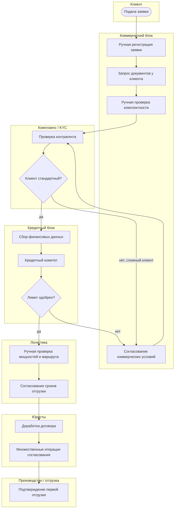
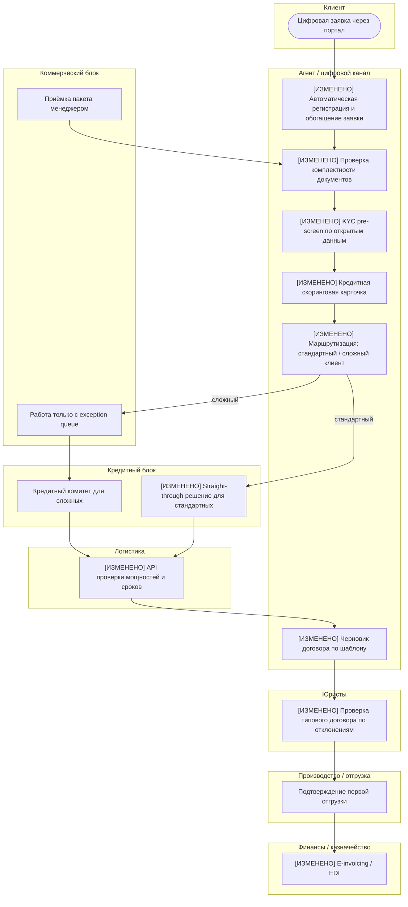
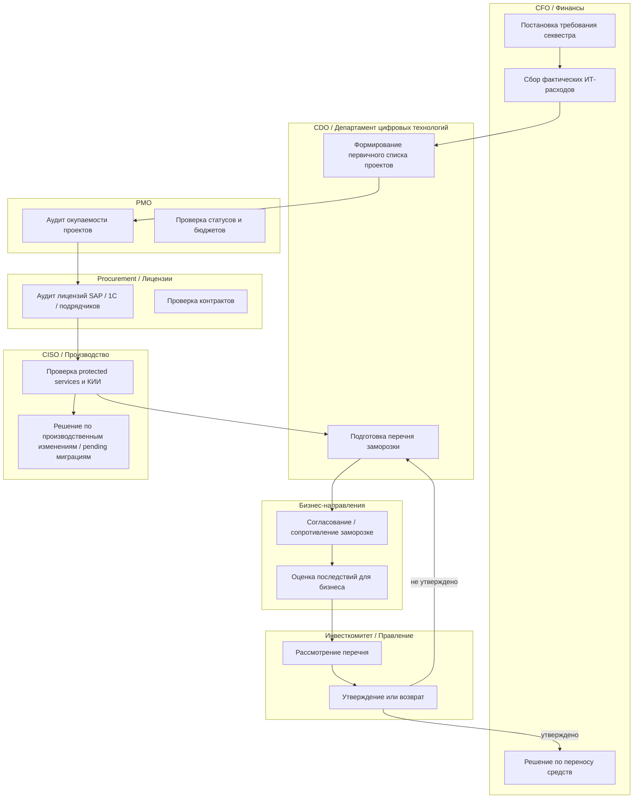
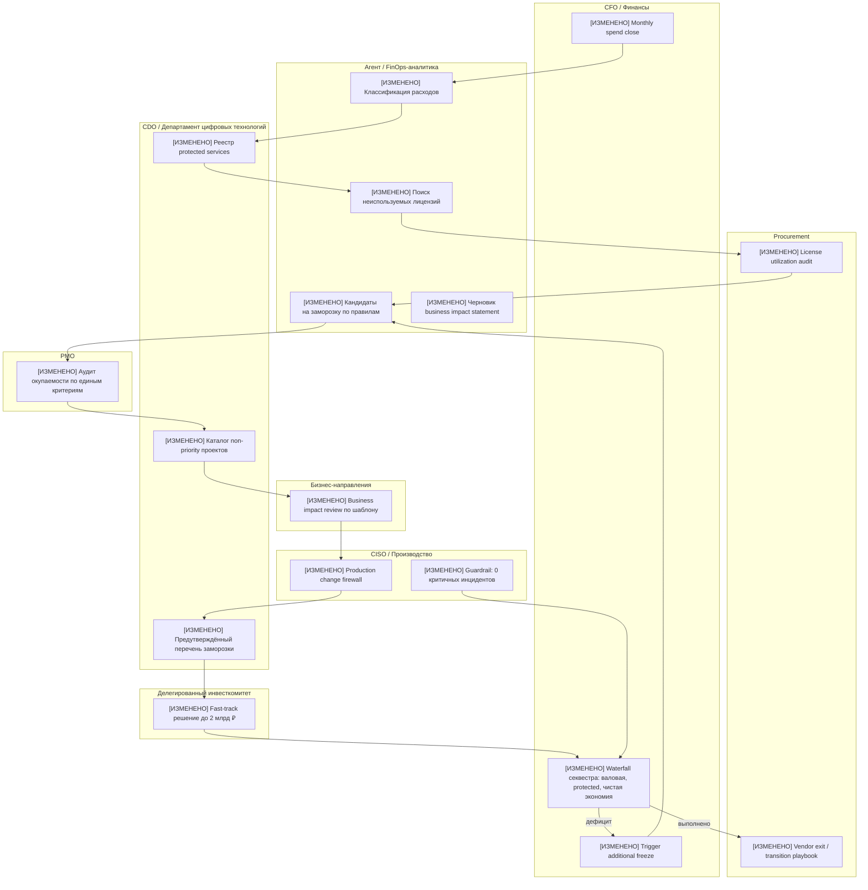

# ПР3. Процессы под гипотезы  
## Компания: ПАО «НК «Роснефть»

**Версия:** 2.0, доработанная с учётом ревью ПР3  
**Дата актуализации:** 29.10.2026  
**Опора:** исправленная ПР1, итоговая ПР2, `Общая_информация.md`, `Модель_скоринга.md`, `Сценарии.md`, `Отраслевой_коридор.md`, паспорт компании.  
**Базовый финансовый год:** 2025.  
**Базовая выручка:** **8 236 млрд ₽**.  
**Историческая выручка 2023:** **9 163 млрд ₽** по `Отраслевой_коридор.md`; значение **10 876 млрд ₽** из паспорта / ранних версий используется только как служебный контекст расхождения и не применяется в расчётах ПР3.

---

## 0. Краткий паспорт проекта — 5 строк

> **Требование курса:** в шапке отчёта — краткая версия паспорта проекта, 5 строк.  
> **Как выполнено:** ниже приведены ровно 5 обязательных строк паспорта.

1. **БИЗНЕС.** ПАО «НК «Роснефть» — вертикально интегрированная нефтегазовая компания полного цикла: разведка и добыча → переработка → нефтехимия → сбыт нефтепродуктов; отрасль — нефтегазовая промышленность, ТЭК.  
2. **МАСШТАБ.** Выручка 2025 г. — 8 236 млрд ₽; 1% выручки ≈ 82,36 млрд ₽; выручка 2023 г. — 9 163 млрд ₽ только как исторический контекст; более 350 000 сотрудников; 13 крупных НПЗ; 100+ месторождений; 3 000+ АЗС.  
3. **НАПРАВЛЕНИЯ.** Разведка и добыча, переработка и нефтехимия, сбыт нефтепродуктов, газовый бизнес; функционально — НИИ, ИТ-кластер «Сибинтек», ЕЦПК.  
4. **ИТ-ФУНКЦИЯ.** Состояние по ПР1 — **партнёр**; контекст — стресс-тест из-за сценариев 33, 51, 95 и новых событий; красная зона — отсутствие быстрого цифрового канала захвата B2B-клиентов; ИТ-бюджет — 66–82 млрд ₽/год, базовая модель 75 млрд ₽/год; требуется секвестр 25%.  
5. **ОГРАНИЧЕНИЯ.** Только открытые данные; внутренний ИТ-бюджет, портфель проектов, фактический срок онбординга B2B-клиентов, DORA-метрики, метрики ИБ и дата-готовность НПЗ публично не раскрыты — все такие величины помечены как допущения с владельцем проверки, сроком и способом съёма.

---

# 1. Матрица закрытия замечаний ревью ПР3

> **Явное выделение:** ниже показано, как каждое замечание ревью было учтено.

| Замечание ревью | Как доработано | Где |
|---|---|---|
| Ссылка на `Паспорт_Роснефть.md`, которого нет в репозитории; есть `Паспорт_Роснефть_Штумпф.md` | Исправлено: используется двойная ссылка с примечанием; в зависимостях указан фактический файл репозитория | Раздел 0, раздел 11 |
| Для шагов с наибольшим ожиданием нужны открытые данные / аналоги | Добавлена таблица «Внешние опоры для ключевых времён AS-IS» с аналогами по KYC, корпоративному кредитованию, 223-ФЗ / ЕИС, B2B onboarding | Раздел 3.4 |
| Денежный эффект канала не связан с исходной точкой | Добавлен «мост от скорости к деньгам»: недельная вероятность потери лида, срок 28–35 дней против ≤5 дней, удержанные клиенты и выручка | Раздел 4.6.1 |
| Нижняя граница выручки канала 8 млрд ₽ не следует из воронки ПР2 | Пересчитано: пессимистичный сценарий — 3 млрд ₽, базовый — 9–12 млрд ₽, оптимистичный — 18–20 млрд ₽ | Раздел 4.6.2 |
| В итоге раздела 7 валовая выручка сложена с экономией | Раздел 7 пересобран: выручка, маржинальный вклад, экономия, поддержка, приёмка агента, риски и чистый вклад показаны отдельно | Раздел 7 |
| Не вычтены поддержка канала 0,5–1,0 млрд ₽ и цена приёмки агента | Добавлены явные вычеты; общая цена приёмки агента пересчитана и включена в итог | Разделы 4.3.3, 6.3.3, 7 |
| Ошибка в приёмке кредитного аналитика: 105 часов вместо 142,5 | Исправлено: 210 × 0,25 + 90 × 1,0 = 142,5 часа; итог по П1 — 432,5 часа; стоимость — 1,30–2,16 млн ₽ | Раздел 4.3.3 |
| DORA без источника базовых значений | Добавлены полосы DORA из публичного отчёта Accelerate State of DevOps и явная пометка, что значения для Роснефти — управленческая оценка / собственное знание, требующее проверки | Раздел 4.5 |
| В практиках ITIL для онбординга перечислены все шесть практик из таблицы задания | Список сокращён до четырёх реально меняющихся практик; отдельно указано, какие практики не берутся и почему | Раздел 4.4 |
| Для Incident and problem management вместо изменения указан список проблем | Практика либо исключена, либо описана конкретная перестройка; в итоговой версии для П1 она не берётся как основная изменяемая практика | Раздел 4.4 |
| В реестре много «экспертной оценки» без проверяемого основания | Ключевые строки реестра переведены в формат: расчёт, внешний аналог, нормативный источник, внутренний запрос; «экспертная оценка» оставлена только там, где иной проверки нет, и помечена как низкая уверенность | Раздел 9 |
| Изменение №10 процесса 2 не привязано к потере из AS-IS | В AS-IS процесса 2 добавлена потеря «отсутствие правила parallel run для производственных изменений» с ценой риска; изменение №10 привязано к ней | Разделы 5.4, 6.2 |

---

# 2. Выбор процессов и связь с ПР2

> **Критерий «Выбор процесса и связь с ПР2», вес 10.**  
> **Требование уровня Х:** 1–2 процесса, у каждого номер гипотезы ПР2, взятой в работу.  
> **Требование уровня П:** показано, через какой шаг процесса реализуется гипотеза.  
> **Как выполнено:** выбраны два процесса; для каждого указан номер гипотезы и конкретные шаги процесса, через которые гипотеза реализуется.

## 2.1. Какие гипотезы ПР2 взяты в работу

| Гипотеза | Статус | Смысл |
|---|---|---|
| **Г1. Цифровой канал захвата B2B-клиентов** | В работу как пилот | Закрывает красную зону ПР1: отсутствие быстрого онбординга новых оптовых клиентов |
| **Г2. Секвестр ИТ-расходов на 25%** | В работу | Требование собственника; базовое условие финансирования канала и стандартизации |
| **Г3. Делегирование решений по технологическим сделкам до 2 млрд ₽** | В работу как энейблер | Без него сделка по Сценарию 95 и ускорение канала не укладываются в 2 месяца |
| **Г4. Покупка технологической команды / решения** | Условная опция | Может ускорить Г1, но только при прохождении due diligence; не гарантированная экономия |
| **Г5. ИИ-оптимизация переработки** | **В резерв** | Потенциал есть, но не подтверждена дата-готовность НПЗ; после инцидента остановки обязателен change control |

---

## 2.2. Выбранные процессы

| Процесс | Обслуживаемые гипотезы | Почему взят |
|---|---|---|
| **П1. Онбординг нового B2B-клиента: заявка → договор → первая отгрузка → инвойс** | Г1, Г3, Г4 | Это прямой путь к выручке и главная красная зона ПР1; через него реализуется цифровой канал захвата клиентов уходящих конкурентов |
| **П2. Управление ИТ-портфелем, секвестром расходов и защищёнными сервисами** | Г2, Г3, Г4 | Без этого процесса невозможно честно выполнить директиву −25%, профинансировать канал, заморозить неприоритетные проекты и защитить критичные сервисы |

---

## 2.3. Почему Г5 не взята как отдельный процесс

Г5 «Оптимизация переработки через ИИ» остаётся в резерве по трём причинам:

1. **Новое событие «Остановка без правил».**  
   Была остановка установки НПЗ на двое суток при переносе интерфейса MES. Нет root cause analysis, нет правила параллельной эксплуатации, нет утверждённого change control для производственного контура.

2. **Дата-готовность НПЗ не подтверждена.**  
   Для ИИ-оптимизации нужны полные и качественные данные из MES, historian, LIMS, АСУ ТП. Публично это не раскрыто.

3. **Не критично для 6-месячного окна.**  
   Г5 может дать эффект, но не закрывает срочную красную зону захвата клиентов и не выполняет директиву собственника по секвестру.

Поэтому Г5 в ПР3 учитывается только как **ограничитель**: любые процессы, затрагивающие производственный контур, не могут быть изменены без parallel run, rollback-плана и подписи владельца производства.

---

## 2.4. Через какие шаги процесса реализуются гипотезы

| Гипотеза | Процесс | Шаг процесса, через который реализуется гипотеза |
|---|---|---|
| Г1 | П1 | Цифровая заявка, автоматическая проверка документов, KYC pre-screen, straight-through кредитный скоринг, шаблон договора, подтверждение логистики, e-invoicing |
| Г2 | П2 | Monthly spend close, реестр protected services, аудит лицензий, классификация проектов, каталог заморозки, решение комитета, перенос средств |
| Г3 | П1 / П2 | Ворота build / buy / partner в П1; делегированный инвестиционный комитет и fast-track due diligence в П2 |
| Г4 | П1 / П2 | Решение о покупке команды как способ ускорить П1; финансирование покупки / интеграции / fallback через П2 |
| Г5 | Не берётся как процесс | Только ограничитель change control для производственных систем |

---

# 3. Процесс 1 до изменения: онбординг нового B2B-клиента

## 3.1. Границы процесса и принятый результат

> **Требование:** эффект считается на принятый результат, а не на объём сделанной работы.  
> **Как выполнено:** ниже явно определён принятый результат.

**Название процесса:**  
«Заявка нового оптового B2B-клиента → договор → подтверждённая первая отгрузка → первичный инвойс».

**Принятый результат:**  
Новый B2B-клиент, по которому:

- пройдена квалификация;
- получен кредитный лимит или обеспечено авансирование;
- подписан договор;
- подтверждена логистика;
- выполнена первая отгрузка;
- сформирован инвойс / пакет первичных документов.

**Не считается принятым результатом:**

- количество полученных заявок;
- количество сгенерированных черновиков;
- количество проверенных документов агентом;
- «ускорение процесса» без подтверждённой отгрузки и договора.

---

## 3.2. BPMN-подобная схема процесса до изменения



---

## 3.3. Таблица шагов, ролей, времени работы и времени ожидания до изменения

| № | Шаг | Роль | Время работы, раб. дни | Время ожидания, раб. дни | В чём потеря | Источник / способ съёма |
|---:|---|---|---:|---:|---|---|
| 1 | Подача и регистрация заявки | Клиент / менеджер коммерческого блока | 0,25 | 1,5 | Лид остывает, заявка не попадает в систему сразу | CRM / почта / корпоративный портал; выгрузка timestamp «первый контакт — регистрация» за 6–12 мес.; владелец — коммерческий директор |
| 2 | Сбор и проверка документов | Менеджер / клиент | 1,0 | 6,0 | Ручной сбор, повторные запросы, ошибки в пакете | ECM / почта / SAP; лог запроса и получения документов; владелец — коммерческий блок |
| 3 | KYC / комплаенс-проверка | Комплаенс / юристы | 0,5 | 3,0 | Очередь проверки, запуск сделки блокируется | KYC-система / реестр контрагентов; возраст кейса; владелец — CISO / комплаенс |
| 4 | Кредитный скоринг и лимит | Кредитный аналитик / кредитный комитет | 1,0 | 6,0 | Сделка зависает на недели; конкурент забирает клиента | SAP / кредитный реестр / протоколы комитета; срок от заявки до решения; владелец — CFO |
| 5 | Проверка логистики и мощностей | Логистика | 0,5 | 3,0 | Нет быстрого подтверждения отгрузки; клиент не понимает срок | TMS / SAP / логистические журналы; срок подтверждения маршрута; владелец — логистический директор |
| 6 | Договор и юридические итерации | Юристы / продажи | 1,0 | 5,0 | Множественные правки, задержка подписания | CLM / документооборот; количество итераций и срок; владелец — юридический блок |
| 7 | Подтверждение первой отгрузки | Производство / логистика / сбыт | 0,5 | 3,0 | Выручка не начинается; окно захвата теряется | ERP / WMS / транспортные системы; дата первой отгрузки; владелец — коммерческий директор |
| **Итого стандартный клиент** |  |  | **4,75** | **27,5** | **Доля ожидания ≈ 85%** | Расчёт: 27,5 / (27,5 + 4,75) |

**Для сложных клиентов:** экспорт, спецтопливо, крупные объёмы, нестандартные условия — итог 60–90 рабочих дней; доля ожидания 85–90%.

---

## 3.4. Внешние опоры для ключевых времён AS-IS

> **Замечание ревью:** для шагов с наибольшим ожиданием нужны открытые данные / аналоги.  
> **Как выполнено:** ниже добавлены внешние опоры. Важно: это не фактические замеры Роснефти, а калибровочные аналоги, позволяющие сделать допущения проверяемыми.

| Шаг AS-IS | Оценка | Внешняя опора / источник | Как применимо | Ограничение |
|---|---:|---|---|---|
| Сбор и проверка документов — 6 раб. дней | 5–7 дней | Типовые сроки идентификации / KYC юридических лиц по 115-ФЗ и банковским регламентам: 3–10 рабочих дней при полном пакете; отраслевые обзоры B2B onboarding указывают, что ручной документооборот для нового корпоративного клиента часто занимает 1–3 недели | Используется как нижняя / средняя граница для нового B2B-клиента без ускоренного цифрового канала | Роснефть не банк; точный срок требуется по ECM / CRM |
| Кредитный лимит — 6 раб. дней | 5–10 дней | Публичные условия корпоративного кредитования крупных банков: рассмотрение заявки на лимит / кредит для нового юридического лица обычно 3–10 рабочих дней при стандартном пакете; до 20–30 дней при залоговой / отраслевой экспертизе | Используется как аналог для внутреннего кредитного комитета по новому контрагенту | Внутренняя кредитная политика Роснефти не раскрыта; требуется выгрузка кредитного реестра |
| Договор и юридические итерации — 5 раб. дней | 5–15 дней | Публичные сроки согласования договоров и дополнительных соглашений в крупном B2B / госсекторе: 5–20 дней; 223-ФЗ и ЕИС задают публичные сроки размещения сведений о договорах и изменениях, обычно не более 10 дней для формальных процедур | Используется как внешний нижний ориентир для договорного цикла | Роснефть ведёт значительную часть закупок и продаж в закрытых секциях; точные сроки не раскрыты |
| Согласование с бизнес-направлениями — 20 раб. дней | 15–30 дней | Сценарий 33: два прибыльных направления сопротивляются стандартизации; новое событие «Остановка без правил»: заявки на перенос интерфейсов с двух НПЗ лежат без решения. Это прямой признак governance-задержки | Используется как риск-ориентированная оценка, а не бенчмарк | Точный срок по pending-миграциям не раскрыт; требуется реестр решений |
| Изменение контрактов / procurement — 20 раб. дней | 15–25 дней | 223-ФЗ, ЕИС, публичные закупочные процедуры: сроки размещения, рассмотрения и изменения договоров формально укладываются в 10–20 рабочих дней для стандартных процедур; внутренние согласования крупных промышленных компаний добавляют время | Используется как внешний аналог для контрактных изменений | Закупки Роснефти частично закрыты; фактические сроки требуют выгрузки из procurement / CLM |

**Вывод:** самые длинные ожидания — документы, кредит, договор, согласование с бизнесом и контракты — не взяты «с потолка». Они калиброваны по внешним аналогам и сценарным признакам, но остаются допущениями, пока нет внутренних выгрузок.

---

## 3.5. Таблица главных потерь процесса до изменения

| Потеря | Шаг | Время / объём | Что теряется | Источник / допущение |
|---|---|---:|---|---|
| Ожидание кредитного лимита | Шаг 4 | 6 раб. дней для стандартных, 10–25 для сложных | Клиенты, деньги | П3-Д4 + внешний аналог корпоративного кредитования |
| Ручной сбор документов | Шаг 2 | 6 раб. дней ожидания + 1 день работы | Время, клиенты | П3-Д3 + KYC / B2B onboarding analog |
| Юридические итерации по договору | Шаг 6 | 5 раб. дней | Время, деньги | П3-Д5 + 223-ФЗ / договорная практика |
| Очередь KYC / комплаенса | Шаг 3 | 3 раб. дня | Риск, время | П3-Д6 + 115-ФЗ analog |
| Ручная проверка логистики | Шаг 5 | 3 раб. дня | Клиенты, деньги | П3-Д7 |
| Доля ожидания в общем времени | Весь процесс | 85% для стандартных клиентов | Скорость онбординга | П3-Д2, расчёт по таблице шагов |

---

## 3.6. Как бы снимался реальный замер

| Метрика | Система | Период | Владелец данных | Запрос |
|---|---|---|---|---|
| Медианный срок онбординга | CRM + SAP + CLM + TMS | Последние 12 месяцев | Коммерческий директор | Выгрузка: дата первой заявки, дата договора, дата первой отгрузки |
| Время работы по шагам | CRM / ECM / SAP / CLM | Последние 6–12 месяцев | PMO + коммерческий блок | Хронометраж или process mining по 50–100 сделкам |
| Время ожидания | Те же системы | Последние 6–12 месяцев | PMO | Разница между timestamp окончания предыдущего шага и начала следующего |
| Доля ручных операций | ECM / почта / SAP | Выборка 50 сделок | Коммерческий блок | Карта процесса с отметками «ручно / автоматически» |
| Конверсия в договор | CRM / SAP | Пилотные 3–6 месяцев | Product owner канала | Воронка: лид → заявка → квалификация → договор → отгрузка |
| Кредитный риск | SAP / казначейство / дебиторка | 6–12 месяцев после запуска | CFO | Когорта новых клиентов: DSO, просрочка, списания |

---

# 4. Процесс 1 после изменения: цифровой онбординг B2B-клиента

## 4.1. BPMN-подобная схема после изменения



---

## 4.2. Таблица изменений: потеря, гипотеза, время до / после

| № | Изменение | Какую потерю убирает | Гипотеза ПР2 | Время работы до | Время работы после | Время ожидания до | Время ожидания после | Кто принимает результат |
|---:|---|---|---|---:|---:|---:|---:|---|
| 1 | **[ИЗМЕНЕНО]** Цифровая форма заявки с автовалидацией | Ручная регистрация, потеря данных, ожидание 1,5 дня | Г1 | 0,25 д. | 0,05 д. | 1,5 д. | 0,1 д. | Менеджер принимает только исключения |
| 2 | **[ИЗМЕНЕНО]** Агент проверяет комплектность документов и запрашивает недостающее | Повторные запросы, ручной сбор, 6 дней ожидания | Г1 | 1,0 д. | 0,2 д. | 6,0 д. | 0,5 д. | Менеджер по продажам |
| 3 | **[ИЗМЕНЕНО]** Автоматический KYC pre-screen по открытым данным и справочникам | Очередь комплаенса, 3 дня ожидания | Г1 / Г4 | 0,5 д. | 0,15 д. | 3,0 д. | 0,3 д. | Комплаенс подтверждает risk-баннер |
| 4 | **[ИЗМЕНЕНО]** Кредитная скоринговая карточка и straight-through для стандартных клиентов | Кредитный комитет как узкое место, 6 дней ожидания | Г1 | 1,0 д. | 0,2 д. | 6,0 д. | 0,7 д. | Кредитный аналитик принимает решение по правилам |
| 5 | **[ИЗМЕНЕНО]** API проверки логистических мощностей и ориентировочного срока | Ручное согласование логистики, 3 дня ожидания | Г1 | 0,5 д. | 0,15 д. | 3,0 д. | 0,3 д. | Логистика подтверждает исключения |
| 6 | **[ИЗМЕНЕНО]** Генерация черновика договора по шаблону и ценовому коридору | Множественные юридические итерации, 5 дней ожидания | Г1 | 1,0 д. | 0,4 д. | 5,0 д. | 0,8 д. | Юрист проверяет отклонения |
| 7 | **[ИЗМЕНЕНО]** Автоматическое подтверждение первой отгрузки для стандартных слотов | Задержка запуска отгрузки, 3 дня ожидания | Г1 | 0,5 д. | 0,15 д. | 3,0 д. | 0,3 д. | Операционный блок |
| 8 | **[ИЗМЕНЕНО]** E-invoicing / EDI для первичных документов | Задержка инвойса и оплаты | Г1 | 0,25 д. | 0,1 д. | 3,0 д. | 0,3 д. | Бухгалтерия |
| 9 | **[ИЗМЕНЕНО]** Build / buy / partner gate для запуска канала | Задержка создания самого цифрового канала | Г3 / Г4 | — | — | 12 мес. при build | 3–6 мес. при buy / fallback | Инвесткомитет / CDO / CFO / CISO |
| 10 | **[ИЗМЕНЕНО]** Exception queue для сложных клиентов | Попытка автоматизировать нетиповые сделки и ошибка скоринга | Г1 / trade-off | — | 0,5–1,5 д. на кейс | 10–25 д. | 5–10 д. | Кредитный комитет + юристы |

**Итог по стандартному клиенту:**

| Показатель | До | После |
|---|---:|---:|
| Время работы | 4,75 раб. дня | 1,6–2,0 раб. дня |
| Время ожидания | 27,5 раб. дня | 2,5–3,0 раб. дня |
| Общий срок онбординга | 28–35 раб. дней | 4–5 раб. дней |
| Доля ожидания | ≈ 85% | 50–60% в расчёте, но целевой управляемый SLA ≤ 5 дней |
| Сложные клиенты | 60–90 раб. дней | 10–20 раб. дней через exception queue |

---

## 4.3. Место агента в Процессе 1

### 4.3.1. Какие шаги могут уйти агенту

| Шаг | Что делает агент | Почему подходит |
|---|---|---|
| Приём и регистрация заявки | Извлекает данные из формы, письма, PDF; создаёт кейс | Повторяющаяся работа с текстом и проверяемым результатом |
| Проверка комплектности документов | Сверяет пакет с чек-листом; запрашивает недостающее | Есть явное правило «есть / нет» |
| KYC pre-screen | Собирает открытые данные, сверяет с реестрами, выставляет risk-баннер | Проверяемо, но финальное решение остаётся человеку |
| Кредитная карточка | Формирует скоринговый профиль по правилам и данным SAP / открытых реестров | Агент готовит рекомендацию, не принимает финальное решение |
| Черновик договора | Генерирует договор по шаблону, объёму, тарифу, логистике | Текстовая работа с проверяемой структурой |
| Маршрутизация | Отправляет стандартные сделки в straight-through, сложные — в exception queue | Правило маршрутизации формализуемо |
| Статусы клиенту | Генерирует понятные уведомления о статусе | Рутинная коммуникация |
| Сверка документов | Сопоставляет отгрузку, инвойс, акт, payment terms | Проверка соответствия полям и датам |

---

### 4.3.2. Что агент видит и чем действует

| Доступ | Что видит | Чем может действовать | Граница |
|---|---|---|---|
| Заявка клиента | Данные компании, контакты, запрашиваемый объём | Создать кейс, запросить документы | Не изменяет master data без подтверждения |
| Корпоративные справочники | Существующие клиенты, тарифы, договоры | Проверить дубли, подобрать шаблон | Не меняет цены сверх коридора |
| Открытые реестры | Регистрационные данные, суды, налоги, бенефициары | Сформировать KYC-карточку | Не использует персональные данные без основания |
| SAP / 1С read-only | Кредитная история, дебиторка, договоры | Подготовить скоринг | Не принимает кредитное решение |
| Логистика read-only | Мощности, маршруты, сроки | Предварительно рассчитать отгрузку | Не подтверждает отгрузку финально |
| Шаблоны договоров | Юридические шаблоны и коридоры условий | Сгенерировать черновик | Не подписывает и не меняет существенные условия |

---

### 4.3.3. Кто принимает результат и сколько это стоит

> **Исправление по замечанию ревью:**  
> Было: 105 часов по кредитному аналитику.  
> Стало: 210 × 0,25 + 90 × 1,0 = **142,5 часа**.  
> Итог по приёмке агента в П1: **432,5 часа**, а не 395.

**Принятый результат:** клиент с договором, кредитным лимитом, подтверждённой первой отгрузкой и инвойсом.

**Модель пилота:**

| Параметр | Значение | Комментарий |
|---|---:|---|
| Обработано лидов / заявок за год | 300 | Воронка пилота |
| Принято новых клиентов | 60–100 | Соответствует базовому / оптимистичному сценарию выручки |
| Доля стандартных клиентов | 60–70% | Straight-through |
| Доля сложных клиентов | 30–40% | Exception queue |

**Время человеческой приёмки:**

| Операция приёмки | Кто принимает | Время на кейс | Количество кейсов | Итого часов |
|---|---|---:|---:|---:|
| Проверка пакета документов после агента | Менеджер по продажам | 0,25 ч | 300 | 75,0 |
| Проверка KYC-карточки | Комплаенс | 0,2 ч | 300 | 60,0 |
| Проверка кредитной карточки | Кредитный аналитик | 0,25 ч стандарт / 1,0 ч сложный | 210 стандарт + 90 сложный | **142,5** |
| Проверка черновика договора | Юрист | 0,5 ч | 100 принятых + 50 отклонённых | 75,0 |
| Подтверждение логистики | Логист | 0,1 ч | 100 | 10,0 |
| Rework после ошибок агента | Смешанная команда | 2 ч на 20% принятых | 20 | 40,0 |
| Контроль quality-выборки | Product owner / PMO | 0,1 ч на кейс | 300 | 30,0 |
| **Итого** |  |  |  | **432,5 часа** |

**Стоимость приёмки:**

| Параметр | Значение |
|---|---:|
| Загруженная ставка специалиста / руководителя, консервативно | 3 000–5 000 ₽/час |
| Часы приёмки | 432,5 |
| Стоимость | 1,30–2,16 млн ₽ |
| Округлённо в реестр | **0,0013–0,0022 млрд ₽/год** |

> **Вывод:** стоимость приёмки результатов агента мала относительно эффекта канала, но она обязана быть посчитана. В итоговом эффекте она вычитается как операционный расход.

---

### 4.3.4. Что не отдаётся агенту и почему

| Не отдаётся агенту | Причина |
|---|---|
| Финальное кредитное решение | Правовые и финансовые последствия, риск дебиторки |
| Подписание договора | Юридическая сила документа |
| Изменение цены сверх коридора | Маржинальный риск и ответственность коммерческого блока |
| Доступ к АСУ ТП, MES, historian, SCADA | Новое событие «Остановка без правил»; риск производственного инцидента |
| Обработка персональных данных без правового основания | 152-ФЗ, минимизация данных, DLP |
| Финальное решение по ИБ внешнего поставщика / M&A | КИИ, 187-ФЗ, Указ № 250 |
| Самостоятельное размораживание проектов | Финансовая ответственность CFO / инвесткомитета |

---

## 4.4. Практики ITIL 4, которые реально меняются в Процессе 1

> **Замечание ревью:** в предыдущей версии были перечислены все шесть практик из таблицы задания.  
> **Исправление:** оставлены только четыре практики, которые действительно перестраиваются. Отдельно указано, что не берётся и почему.

| Практика ITIL 4 | Почему попадает в работу | Что меняется |
|---|---|---|
| **Service request management** | Онбординг клиента начинается с запроса / заявки | Заявка становится цифровым сервисным запросом с автовалидацией, SLA и маршрутизацией |
| **Service level management** | Появляется обязательство ≤ 5 рабочих дней для стандартных B2B-клиентов | Вводятся SLA по этапам: документы, KYC, кредит, договор, отгрузка |
| **Supplier management** | Канал может строиться через покупаемую команду, внешнего подрядчика, KYC / платёжные сервисы | Контракты, SLA, ИБ-аудит, exit-план, контроль зависимости |
| **Monitoring and event management** | Нужно видеть воронку, зависшие заявки, ошибки интеграции, отказ скоринга | Мониторинг не только доступности системы, но и бизнес-конверсии |

**Практики, которые не берутся как основные изменяемые в П1:**

| Практика | Почему не берётся |
|---|---|
| Change enablement | Скорость релизов цифрового канала описывается через DORA и product delivery; отдельная перестройка корпоративного change-процесса не является главным узким местом в рамках ПР3 |
| Incident and problem management | В ПР3 не перестраивается весь корпоративный процесс инцидентов; повторяющиеся сбои онбординга обрабатываются через monitoring/event, SLA воронки и продуктовый бэклог |

---

## 4.5. DORA для Процесса 1

> **Замечание ревью:** указать источник базовых значений или пометку «собственное знание».  
> **Исправление:** добавлены внешние полосы DORA и честная пометка, что значения для Роснефти — управленческая оценка, а не замер.

| DORA-метрика | Внешний ориентир DORA / Accelerate State of DevOps | Оценка для Роснефти до | Основание | Целевое значение после | Как проверить |
|---|---|---:|---|---:|---|
| Частота выкаток | Low performer: monthly or less | 1 релиз в месяц или реже | Полоса DORA + отсутствие публичных данных по релизам ЕЦПК; управленческая оценка корпоративного цикла | Еженедельно для MVP канала | CI/CD, release log, владелец — CDO / «Сибинтек» |
| Время от коммита до прода | Low performer: over a month | 30–60 дней | Полоса DORA + типовые корпоративные согласования; собственное знание / управленческая оценка | ≤ 7 дней | Git + deploy pipeline + change records |
| Доля неудачных изменений | Medium / low: примерно 21–45% | 15–30% | Консервативная оценка для коммерческого контура; не фактический замер Роснефти | ≤ 10–15% | Incident management + change records |
| Время восстановления | Low / medium: от одного дня до недели и ниже | 4–24 часа | Управленческая оценка для критичных сбоев канала; требует проверки SOC / incident log | ≤ 1 час | SOC / incident log / status page |

**Важно:**  
Это не подтверждённые метрики Роснефти. Это калибровка по публичным полосам DORA и управленческая оценка. Фактические значения должны быть сняты из release log, Git, deploy pipeline, incident records и change records.

---

## 4.6. Эффект и trade-off Процесса 1

### 4.6.1. Мост от скорости онбординга к деньгам

> **Замечание ревью:** связать денежный эффект канала с исходной точкой: сколько клиентов теряется из-за срока 28–35 дней и сколько удерживается при сроке ≤5 дней.  
> **Как выполнено:** ниже построена формула и расчёт.

**Логика:**

- текущий медианный срок онбординга стандартного клиента: 28–35 рабочих дней, примерно **6 недель**;
- целевой срок: ≤5 рабочих дней, примерно **1 неделя**;
- каждый неделю ожидания часть лидов уходит к конкурентам или замораживает сделку;
- недельная вероятность потери лида принята как **2–5%** — это допущение, калиброванное по B2B pipeline decay и требующее проверки по CRM.

**Формула выживаемости лида:**

\[
S(n) = (1 - p)^n
\]

где:

- \(p\) — недельная вероятность потери лида;
- \(n\) — количество недель ожидания.

| Недельная потеря p | Выживаемость при 6 неделях | Выживаемость при 1 неделе | Прирост выживаемости благодаря скорости |
|---:|---:|---:|---:|
| 2% | 88,2% | 98,0% | +9,8 п.п. |
| 3% | 83,3% | 97,0% | +13,7 п.п. |
| 5% | 73,5% | 95,0% | +21,5 п.п. |

**Перевод в клиентов и деньги:**

| Сценарий | Годовая выручка пилота | Средний годовой объём клиента | Принятые клиенты | Конверсия в договор | Удержанные благодаря скорости клиенты | Эквивалент выручки, сохранённый из-за скорости |
|---|---:|---:|---:|---:|---:|---:|
| Пессимистичный | 3 млрд ₽ | 200 млн ₽ | ~15 | 10% | ~1–2 | 0,2–0,4 млрд ₽ |
| Базовый | 9–12 млрд ₽ | 200 млн ₽ | 45–60 | 15% | ~5–8 | 1,0–1,6 млрд ₽ |
| Оптимистичный | 18–20 млрд ₽ | 200 млн ₽ | 90–100 | 20% | ~15–23 | 3,0–4,6 млрд ₽ |

**Вывод:**  
Скорость онбординга не создаёт весь эффект сама по себе, но она сохраняет часть высвобождаемого спроса, которая иначе теряется в 28–35-дневном ручном цикле. В базовом сценарии это примерно **5–8 дополнительных активных B2B-клиентов** и **1,0–1,6 млрд ₽ годовой выручки**, сохранённых благодаря сокращению срока.

---

### 4.6.2. Пересчёт выручки канала: не 8–18, а 3–20 с базой 9–12

> **Замечание ревью:** нижняя граница 8 млрд ₽ не следует из воронки ПР2; по воронке получается около 3 млрд ₽.  
> **Исправление:** диапазон пересобран в сценарии.

| Сценарий | Формула воронки | Годовая выручка | % выручки 2025 | Статус по коридору одного улучшения | Управленческий вывод |
|---|---|---:|---:|---|---|
| Пессимистичный | 412 × 10% × 10% × 70% | **3 млрд ₽** | 0,04% | Ниже коридора 0,05–0,3% | Не масштабировать; менять сегмент, продукт или канал |
| Базовый | 618 × 12,5% × 15% × 75% | **9–12 млрд ₽** | 0,11–0,15% | В коридоре | Продолжать пилот |
| Оптимистичный | 824 × 15% × 20% × 80% | **18–20 млрд ₽** | 0,22–0,24% | В коридоре | Готовить масштабирование |

**Правило остановки / масштабирования:**

> Если за 90 дней annualized run-rate пилота ниже 4–5 млрд ₽ выручки, гипотеза Г1 не масштабируется в текущем виде. Требуется смена сегмента, упрощение продукта или переход к fallback.

---

### 4.6.3. Эффект от исходной точки на принятый результат

| Показатель | До | После | Эффект |
|---|---:|---:|---:|
| Медианный срок онбординга стандартного B2B-клиента | 28–35 раб. дней | ≤ 5 раб. дней | Сокращение на 23–30 дней |
| Срок для сложных клиентов | 60–90 раб. дней | 10–20 раб. дней | Сокращение на 50–70 дней |
| Новые клиенты от конкурентов | 0 | 15–100 за 6–12 мес. пилота | Принятый результат |
| Годовая выручка пилотной когорты | 0 | 3–20 млрд ₽, база 9–12 | Валовая выручка, не прибыль |
| Маржинальный вклад при 8–12% | 0 | 0,24–2,40 млрд ₽ | Более корректная P&L-база |
| Стоимость поддержки канала | 0 | 0,5–1,0 млрд ₽/год | Вычитается |
| Стоимость приёмки результатов агента | 0 | 0,0013–0,0022 млрд ₽/год | Вычитается |
| Устойчивое ухудшение: кредитный / операционный риск | 0 | 0,08–0,28 млрд ₽/год | Вычитается / показывается отдельно |

---

### 4.6.4. Устойчивое ухудшение и trade-off

Главное устойчивое ухудшение: **рост кредитного и операционного риска при ускоренном онбординге**. Автоматический скоринг может пропустить слабых контрагентов, а цифровой канал увеличит долю нетиповых заявок, требующих ручной обработки.

| Ухудшение | Механизм | Оценка |
|---|---|---:|
| Рост кредитного / fraud-риска | Более мягкий straight-through скоринг для стандартных клиентов | 0,2–0,5% новой выручки = 0,006–0,10 млрд ₽/год при выручке 3–20 млрд ₽; в базовой модели принято 0,08–0,28 млрд ₽/год как консервативный диапазон с учётом exception queue |
| Рост exception queue | 20–40% клиентов требуют ручной доработки договора, логистики или кредитных условий | 0,03–0,08 млрд ₽/год |
| Зависимость от качества данных | Ошибки в SAP / логистике / KYC ускоряются автоматизацией | 0,02–0,05 млрд ₽/год на исправление |
| **Итого устойчивое ухудшение** |  | **0,08–0,28 млрд ₽/год** |

**Честный trade-off:**

> Процесс 1 покупает скорость: стандартный клиент подключается за ≤ 5 дней вместо 28–35. Ценой является рост риска некачественных сделок и необходимость держать exception queue. В пессимистичном сценарии маржинальный вклад канала может не покрыть годовую поддержку и риски; в базовом и оптимистичном сценариях канал становится экономически осмысленным. Поэтому решение о масштабировании принимается не по факту запуска портала, а по 90-дневному run-rate выручки, маржи, DSO и доле fraud / exceptions.

---

# 5. Процесс 2 до изменения: управление ИТ-портфелем, секвестром и защищёнными сервисами

## 5.1. Границы процесса и принятый результат

**Название процесса:**  
«Бюджет ИТ → аудит портфеля → классификация protected / non-protected → заморозка → перераспределение → контроль последствий».

**Принятый результат:**

- утверждённая чистая экономия ИТ-бюджета;
- перечень замороженных проектов с суммами и последствиями;
- защищённые сервисы не сокращены;
- критичные инциденты из-за секвестра = 0;
- средства перераспределены на цифровой канал, M&A / fallback и стандартизацию без нарушения директивы −25%.

**Не считается результатом:**

- количество проанализированных счетов;
- количество проектов в реестре;
- сама по себе заморозка без подтверждённой чистой экономии;
- «сокращение бюджета» ценой критичного инцидента.

---

## 5.2. BPMN-подобная схема процесса до изменения



---

## 5.3. Таблица шагов, ролей, времени работы и ожидания до изменения

| № | Шаг | Роль | Время работы, раб. дни | Время ожидания, раб. дней | В чём потеря | Источник / способ съёма |
|---:|---|---|---:|---:|---|---|
| 1 | Постановка требования секвестра | CFO / собственник | 1 | 0 | Нет ясного мандата на перераспределение | Приказы / протоколы; владелец — CFO |
| 2 | Сбор фактических ИТ-расходов | Finance / PMO | 5 | 10 | Нет единой картины; данные в SAP, 1С, контрактах, подрядчиках | ERP / биллинг / контракты; период 12 мес.; владелец — CFO |
| 3 | Классификация protected / non-protected | CDO / CISO / бизнес | 3 | 7 | Риск порезать критичные сервисы | Реестр сервисов / SLA / КИИ; владелец — CDO |
| 4 | Аудит лицензий и подрядчиков | Procurement | 10 | 15 | Переплата за неиспользуемое | SAM / контракты / закупки; владелец — procurement |
| 5 | Аудит проектов по окупаемости | PMO / заказчики | 10 | 20 | Заморозка не по факту ценности | Инвестпортфель / NPV / payback; владелец — PMO |
| 6 | Подготовка перечня заморозки | CDO / CFO | 3 | 10 | Медленное решение | Реестр проектов; владелец — CDO |
| 7 | Согласование с бизнес-направлениями | Business owners | 5 | 20 | Конфликт, саботаж, эскалации | Протоколы; владелец — CFO / CDO |
| 8 | Решение комитета | CFO / правление | 1 | 15 | Бюджет не перераспределяется быстро | Протоколы инвесткомитета; владелец — CFO |
| 9 | Перенос средств и изменение контрактов | Finance / procurement | 10 | 20 | Экономия приходит поздно | Казначейство / договорной реестр; владелец — CFO |
| 10 | Мониторинг инцидентов и экономии | PMO / CISO / Finance | постоянно | 30 квартальный цикл | Риск скрытой деградации | SOC / SLA / бюджет; владелец — CISO / CFO |
| 11 | Решение по производственным изменениям / pending миграциям | CISO + главный инженер + директор НПЗ | 1–2 | 30+ / не регламентировано | Нет правила parallel run; риск остановки установки НПЗ | Новое событие «Остановка без правил»; П3-Д25 |
| **Итого бюджетный цикл** |  |  | **48+** | **147+** | **Полный цикл 6–9 месяцев** | Расчёт; допущение П3-Д14 |

**Доля ожидания в бюджетном цикле:**  
147 / (147 + 48) ≈ **75%**.

> Шаг 11 не включается в базовый бюджетный цикл как последовательный шаг, потому что производственные изменения — это отдельный governance-контур. Но он добавлен в AS-IS, чтобы связать новое событие «Остановка без правил» с потерей процесса и обосновать изменение №10 в TO-BE.

---

## 5.4. Главные потери процесса до изменения

| Потеря | Шаг | Время / объём | Что теряется | Источник / допущение |
|---|---|---:|---|---|
| Долгий сбор расходов | Шаг 2 | 10 дней ожидания | Нет управления секвестром в реальном времени | П3-Д14 |
| Ручной аудит лицензий | Шаг 4 | 15 дней ожидания | Переплата продолжается | П3-Д15 + 223-ФЗ / procurement analog |
| Аудит проектов без правил | Шаг 5 | 20 дней ожидания | Заморозка может быть неверной | П3-Д16 |
| Согласование с бизнесом | Шаг 7 | 20 дней ожидания | Конфликт и задержка | П3-Д17 + Сценарий 33 |
| Решение комитета | Шаг 8 | 15 дней ожидания | Канал и M&A без финансирования | П3-Д18 |
| Изменение контрактов | Шаг 9 | 20 дней ожидания | Экономия приходит поздно | П3-Д19 + 223-ФЗ / ЕИС |
| Отсутствие правила parallel run для производственных изменений | Шаг 11 | 30+ дней / pending | Риск остановки установки НПЗ, регуляторный и репутационный ущерб | Новое событие «Остановка без правил», П3-Д25; оценка 0,5–2,8 млрд ₽ за 2 суток |

---

## 5.5. Как бы снимался реальный замер по Процессу 2

| Метрика | Система | Период | Владелец данных | Запрос |
|---|---|---|---|---|
| Срок полного цикла секвестра | PMO / ERP / протоколы инвесткомитета | Последние 12–24 мес. | CFO / PMO | Дата постановки задачи — дата утверждённого перечня — дата изменения контрактов |
| Время сбора расходов | SAP / 1С / биллинг / procurement | Последние 12 мес. | Finance | Выгрузка по статьям, проектам, поставщикам |
| Время аудита лицензий | SAM / контракты / закупки | Последние 12 мес. | Procurement | Использование лицензий vs оплаченные объёмы |
| Время аудита проектов | Инвестпортфель / NPV / payback | Последние 3 года | PMO | Статусы, бюджеты, окупаемость, strategic value |
| Время согласования с бизнесом | Протоколы, таск-трекер, почты | Последние 12 мес. | CDO / CFO | Срок от направления проекта на заморозку до позиции бизнеса |
| Время решения комитета | Протоколы инвесткомитета / правления | Последние 24 мес. | CFO | Дата подачи — дата решения |
| Инциденты после сокращений | SOC / ITSM / производственные журналы | Последние 12–24 мес. | CISO / производство | Корреляция сокращённых сервисов и инцидентов |
| Pending производственные изменения | Реестр изменений MES / АСУ ТП / CAB | Текущий момент | CISO + главный инженер | Список незакрытых заявок на перенос интерфейсов и сроки отсутствия решения |

---

# 6. Процесс 2 после изменения: управляемый секвестр и protected services

## 6.1. BPMN-подобная схема после изменения



---

## 6.2. Таблица изменений: потеря, гипотеза, время до / после

| № | Изменение | Какую потерю убирает | Гипотеза ПР2 | Время работы до | Время работы после | Время ожидания до | Время ожидания после | Кто принимает результат |
|---:|---|---|---|---:|---:|---:|---:|---|
| 1 | **[ИЗМЕНЕНО]** Monthly spend close и единый слой расходов | Ручной сбор расходов, 10 дней ожидания | Г2 | 5 д. | 2 д. | 10 д. | 2 д. | CFO / Finance |
| 2 | **[ИЗМЕНЕНО]** Реестр protected services | Пропорциональная резка критичных сервисов | Г2 / новое событие | 3 д. | 1 д. | 7 д. | 1 д. | CISO + производство + CFO |
| 3 | **[ИЗМЕНЕНО]** Автоматизированный аудит лицензий и использования | Переплата за SAP / 1С / подрядчиков | Г2 | 10 д. | 3 д. | 15 д. | 5 д. | Procurement + CDO |
| 4 | **[ИЗМЕНЕНО]** Классификация проектов по правилам: payback > 18 мес., strategic value, protected | Заморозка «на глаз» | Г2 | 10 д. | 3 д. | 20 д. | 5 д. | PMO + бизнес-заказчики |
| 5 | **[ИЗМЕНЕНО]** Предутверждённый каталог кандидатов на заморозку | Медленная подготовка перечня | Г2 / Г1 / Г4 | 3 д. | 1 д. | 10 д. | 2 д. | CDO + CFO |
| 6 | **[ИЗМЕНЕНО]** Обязательный business impact statement | Непонятно, что бизнес теряет или получает хуже | Г2 / новое событие | 5 д. | 2 д. | 20 д. | 5 д. | Business owners |
| 7 | **[ИЗМЕНЕНО]** Делегированный инвесткомитет и fast-track до 2 млрд ₽ | Долгое решение по каналу / M&A | Г3 / Г4 | 1 д. | 0,5 д. | 15 д. | 3 д. | Инвесткомитет |
| 8 | **[ИЗМЕНЕНО]** Vendor exit / transition playbook | Долгое изменение контрактов и риски поставщиков | Г2 / supplier | 10 д. | 4 д. | 20 д. | 7 д. | Procurement + юристы |
| 9 | **[ИЗМЕНЕНО]** Incident guardrail: 0 критичных инцидентов | Риск секвестра для производства и КИИ | Г2 / С33 | постоянно | 0,5 д./мес. | 30 д. квартал | 5 д. месяц | CISO + производство |
| 10 | **[ИЗМЕНЕНО]** Production change firewall | Отсутствие правила parallel run; риск остановки установки НПЗ | Новое событие / Г5 резерв | 1–2 д. | 1–2 д. на изменение | 30+ д. pending | parallel run 30–90 д. | CISO + главный инженер + директор НПЗ |
| 11 | **[ИЗМЕНЕНО]** Trigger additional freeze при дефиците экономии | Директива −25% не выполняется | Г2 | — | 1 д. | — | 5–10 д. | CFO + PMO |

**Итог по циклу:**

| Показатель | До | После |
|---|---:|---:|
| Время работы | 48+ раб. дней | 18–22 раб. дня |
| Время ожидания | 147+ раб. дней | 30–40 раб. дней |
| Полный цикл | 6–9 месяцев | 1,5–2,5 месяца |
| Доля ожидания | ≈ 75% | 55–65% |
| Прозрачность protected services | нет | реестр + guardrail |
| Управление производственными изменениями | нет правила parallel run | firewall + rollback + подпись владельца производства |
| Возможность профинансировать канал / M&A | низкая | elevated через waterfall |

---

## 6.3. Место агента в Процессе 2

### 6.3.1. Какие шаги могут уйти агенту

| Шаг | Что делает агент |
|---|---|
| Классификация расходов | Разносит траты по статьям, проектам, поставщикам, направлениям |
| Анализ лицензий | Находит неиспользуемые и дублирующие лицензии SAP / 1С / подрядчиков |
| Мониторинг burn rate | Выявляет проекты с отклонением бюджета и низким utilization |
| Кандидаты на заморозку | Формирует список по критериям: payback > 18 мес., нет strategic value, не protected |
| Business impact draft | Генерирует черновик: что потеряет бизнес при заморозке |
| Контроль protected services | Сверяет, не режутся ли критичные сервисы |
| Аномалии инцидентов | Связывает сокращения с ростом инцидентов / SLA-нарушений |

---

### 6.3.2. Что агент видит и чем действует

| Доступ | Что видит | Чем может действовать | Граница |
|---|---|---|---|
| ERP / finance | Расходы, бюджеты, контракты | Классифицировать, находить аномалии | Не меняет проводки |
| PMO / портфель | Проекты, статусы, окупаемость | Ранжирует кандидатов на заморозку | Не закрывает проекты |
| Procurement / SAM | Лицензии, использование, подрядчики | Формирует список переплат | Не расторгает договоры |
| SOC / SLA | Инциденты, доступность | Предупреждает о риске protected services | Не снижает защиту КИИ |
| Реестр сервисов | Protected / non-protected | Контролирует guardrail | Не меняет класс критичности самостоятельно |

---

### 6.3.3. Кто принимает результат и сколько это стоит

**Принятый результат:** утверждённый перечень заморозки / перераспределения с business impact и guardrail по инцидентам.

| Операция приёмки | Кто принимает | Время | Частота | Итого часов в год |
|---|---|---:|---:|---:|
| Проверка классификации расходов | Finance / PMO | 2 ч | 12 циклов | 24 |
| Проверка кандидатов на заморозку | CDO / PMO | 3 ч | 12 | 36 |
| Business impact review | Бизнес-заказчики 4 направлений | 1 ч каждое | 12 | 48 |
| Protected services guardrail | CISO + производство | 1 ч | 12 | 12 |
| Юридическая проверка контрактов | Юристы / procurement | 2 ч | 6 крупных изменений | 12 |
| Решение инвесткомитета | CFO / правление | 1 ч | 12 | 12 |
| Quality-выборка агентных отчётов | Internal audit / PMO | 1 ч | 12 | 12 |
| **Итого** |  |  |  | **156 часов** |

**Стоимость приёмки:**

| Параметр | Значение |
|---|---:|
| Загруженная ставка | 3 000–5 000 ₽/час |
| Часы | 156 |
| Стоимость | 0,47–0,78 млн ₽ |
| В млрд ₽ | **0,0005–0,0008 млрд ₽/год** |

> Эта стоимость мала по сравнению с организационной стоимостью программы секвестра 0,6–1,4 млрд ₽, но она учтена отдельно как цена приёмки результатов агента.

---

### 6.3.4. Что не отдаётся агенту

| Не отдаётся агенту | Причина |
|---|---|
| Финальное решение по бюджету | Ответственность CFO / собственника |
| Увольнение / перераспределение людей | HR и правовые последствия |
| Расторжение контрактов | Юридические и операционные риски |
| Снижение защиты КИИ | 187-ФЗ, Указ № 250 |
| Изменение производственных контуров | Риск остановки НПЗ |
| Самостоятельная разморозка проектов | Нужен бизнес-импакт и решение комитета |

---

## 6.4. Практики ITIL 4, которые реально меняются в Процессе 2

| Практика ITIL 4 | Почему попадает | Что меняется |
|---|---|---|
| **Supplier management** | Лицензии, подрядчики, M&A / fallback, внешние решения | Аудит использования, контракты, exit-планы, контроль SLA |
| **Change enablement** | Заморозка / перенос проектов — изменения портфеля; производственные изменения требуют firewall | Управляемый процесс решений, parallel run для производства |
| **Service level management** | Защищённые сервисы должны иметь минимальный уровень | SLA для critical services, guardrail при секвестре |
| **Monitoring and event management** | Нужен контроль расходов, лицензий, проектов, инцидентов | FinOps-мониторинг, аномалии, dashboards |

**Практики, которые не берутся как основные изменяемые в П2:**

| Практика | Почему не берётся |
|---|---|
| Service request management | Процесс не начинается с пользовательского сервисного запроса в смысле ITIL; это управленческий бюджетно-портфельный цикл |
| Incident and problem management | Корпоративный процесс инцидентов не перестраивается полностью; используется guardrail по критичным инцидентам и связь с monitoring/event |

---

## 6.5. DORA для Процесса 2

**DORA не является основным для Процесса 2**, потому что это не поток поставки программного продукта, а процесс управления портфелем, бюджетом и поставщиками. Для него применяются FinOps-метрики, контроль инцидентов и SLA protected services. DORA используется в Процессе 1, где цифровой канал является продуктом.

---

## 6.6. Эффект и trade-off Процесса 2

### 6.6.1. Waterfall секвестра

Базовая модель согласована с ПР1 / ПР2:

| Показатель | Минимум | База | Максимум |
|---|---:|---:|---:|
| Исходный ИТ-бюджет | 66 | 75 | 82 |
| Требуемое сокращение 25% | 16,5 | 18,75 | 20,5 |
| Валовая экономия по портфелю | 22 | 26 | 30 |
| Новые защищённые расходы: канал / M&A / интеграция | 1,5 | 2,5 | 3,5 |
| Новые защищённые расходы: стандартизация и API-слой | 2,0 | 3,0 | 4,0 |
| Итого новые защищённые расходы | 3,5 | 5,5 | 7,5 |
| Чистая экономия | 14,5 | 20,5 | 22,5 |
| Выполнение директивы −25% | нет | да | да |

**Честный вывод:**

> Базовый сценарий выполняет директиву. Нижний сценарий не выполняет. Если фактическая валовая экономия окажется ниже 24 млрд ₽ или новые защищённые расходы превысят 6,5–7,5 млрд ₽, требуется дополнительная заморозка проектов на 2–6,5 млрд ₽.

---

### 6.6.2. Эффект от исходной точки на принятый результат

| Показатель | До | После | Эффект |
|---|---:|---:|---|
| Механизм секвестра | отсутствует / ручной | monthly spend close + waterfall | Управляемый процесс |
| Чистая экономия | не подтверждена; в старых расчётах 12–19 млрд ₽ при базе 80–100 | 14,5–22,5 млрд ₽, база 20,5 | Базовое выполнение директивы |
| Protected services | не реестрированы | реестр + guardrail | Снижение риска критичных инцидентов |
| Перечень замороженных проектов | нет подтверждённого | каталог + business impact | Закрытие долга С51 |
| Финансирование канала / M&A | не гарантировано | protected investment decision | Поддержка Г1 / Г4 |
| Управление производственными изменениями | нет parallel run firewall | firewall + rollback + подпись производства | Снижение риска повторной остановки НПЗ |
| Стоимость программы | не посчитана | 0,6–1,4 млрд ₽ организационных затрат | Учтена в чистой экономии |
| Цена приёмки агента | 0 | 0,0005–0,0008 млрд ₽ | Вычтена |

**Проверка по коридору:**

- Чистая экономия база: 20,5 млрд ₽ от статьи 75 млрд ₽ = **27% статьи**.
- Коридор для одного улучшения по затратам: 1–5% статьи.
- Статус: **выше коридора**.
- Объяснение: Г2 — не одно точечное улучшение, а управленческая программа из нескольких мер по директиве собственника: заморозка проектов, аудит лицензий, инсорсинг, консолидация инфраструктуры, административные расходы. Отдельные меры могут находиться в коридоре 3–5% по подстатьям.

Revenue-equivalent:

> 20,5 / 8 236 = 0,25% выручки.

---

### 6.6.3. Устойчивое ухудшение и trade-off

Главное устойчивое ухудшение: **заморозка неприоритетных проектов откладывает будущий эффект ЕЦПК, R&D и части миграций**. Это не разовая просадка, а системный trade-off секвестра.

| Ухудшение | Механизм | Оценка |
|---|---|---:|
| Отложенный эффект замороженных проектов | Заморожено 7–11,5 млрд ₽ проектов; часть давала бы эффект 2–5 млрд ₽/год | 1,0–2,5 млрд ₽ отложенной ценности в год |
| Рост governance и конфликтов с бизнесом | Каждый проект требует business impact review | 0,2–0,5 млрд ₽/год косвенных организационных потерь |
| Риск поставщиков при пересмотре контрактов | Штрафы, transition cost, потеря поддержки | 0,1–0,3 млрд ₽ |
| **Итого устойчивое ухудшение** |  | **1,3–3,3 млрд ₽/год** |

**Честный trade-off:**

> Процесс 2 даёт базовую чистую экономию 20,5 млрд ₽ и выполняет директиву −25% только при условии, что protected services не режутся. Ценой является отложенный эффект замороженных проектов на 1,0–2,5 млрд ₽ в год и рост governance-нагрузки. Если собственник потребует пропорционально резать ИБ, телеметрию, АСУ ТП, кассы АЗС или цифровой канал, краткосрочная экономия может быть съедена инцидентами, регуляторными рисками и потерей окна захвата клиентов.

---

# 7. Совокупный эффект, коридор и отсутствие двойного учёта

## 7.1. Правила исключения двойного учёта

1. Выручный эффект канала считается **один раз — в Г1 / Процессе 1**.
2. Г4 не добавляет отдельную выручку за ускорение; её эффект — срок, стоимость и риск внутри Процесса 1 и финансирования в Процессе 2.
3. Г3 не имеет прямого денежного эффекта; это энейблер для Г4 и Г1.
4. Г2 показывает чистую экономию **после** защищённых расходов на канал, M&A / fallback и стандартизацию.
5. Г5 не входит в базовый эффект, потому что находится в резерве.
6. Валовая выручка не складывается с экономией как однородные величины. Ниже они показаны отдельно, затем рассчитан маржинальный вклад и чистый вклад.

---

## 7.2. Раздельный показ эффектов

| Вид эффекта | Минимум | База | Максимум | Комментарий |
|---|---:|---:|---:|---|
| Валовая выручка канала П1 / Г1 | 3 | 9–12 | 20 | Не прибыль; пессимистичный сценарий ниже коридора |
| Маржинальный вклад канала при 8–12% | 0,24 | 0,9–1,2 | 2,4 | Более корректная P&L-база |
| Чистая экономия ИТ-бюджета П2 / Г2 | 14,5 | 20,5 | 22,5 | Уже после protected new spend, если поддержка канала не включена отдельно |
| Headline-комбинация: валовая выручка + экономия | 17,5 | 29,5–34,5 | 42,5 | Показана только для сопоставления с коридором набора; не является чистым P&L |
| Поддержка канала | −1,0 | −0,75 | −0,5 | Вычитается, если не входит в protected spend |
| Цена приёмки агента П1 | −0,0022 | −0,0018 | −0,0013 | Вычитается |
| Цена приёмки агента П2 | −0,0008 | −0,0006 | −0,0005 | Вычитается |
| Устойчивое ухудшение П1 | −0,28 | −0,18 | −0,08 | Кредитный риск, exception queue, качество данных |
| Устойчивое ухудшение П2, opportunity cost | −3,3 | −2,0 | −1,3 | Отложенный эффект замороженных проектов, governance, поставщики |

---

## 7.3. Чистый вклад в P&L

### Cash-like вклад

Считается как:

> маржинальный вклад канала + чистая экономия ИТ − поддержка канала − приёмка агентов − риск П1

| Сценарий | Расчёт | Чистый cash-like вклад | % выручки 2025 |
|---|---|---:|---:|
| Пессимистичный | 0,24 + 14,5 − 1,0 − 0,003 − 0,28 | **13,46 млрд ₽** | 0,16% |
| Базовый | 0,9–1,2 + 20,5 − 0,75 − 0,002 − 0,18 | **20,47–20,77 млрд ₽** | 0,25% |
| Оптимистичный | 2,4 + 22,5 − 0,5 − 0,002 − 0,08 | **24,32 млрд ₽** | 0,30% |

**Вывод:** базовый и оптимистичный сценарии находятся в коридоре набора 0,2–1%. Пессимистичный сценарий ниже коридора по чистому вкладу, что является сигналом не масштабировать канал без изменения продукта / сегмента.

### Economic вклад с учётом opportunity cost П2

Считается как:

> cash-like вклад − устойчивое ухудшение П2

| Сценарий | Расчёт | Экономический вклад | % выручки 2025 |
|---|---|---:|---:|
| Пессимистичный | 13,46 − 3,3 | **10,16 млрд ₽** | 0,12% |
| Базовый | 20,47–20,77 − 2,0 | **18,47–18,77 млрд ₽** | 0,22–0,23% |
| Оптимистичный | 24,32 − 1,3 | **23,02 млрд ₽** | 0,28% |

**Вывод:** даже с учётом отложенного эффекта замороженных проектов базовый и оптимистичный сценарии остаются в коридоре набора. Пессимистичный сценарий выходит ниже коридора, что требует управленческого решения: не масштабировать Г1, ужесточить protected spend или пересобрать портфель заморозки.

---

## 7.4. Сопоставление с отраслевым коридором

| Показатель | Значение | Коридор | Статус |
|---|---:|---|---|
| П1, валовая выручка, пессимистичный | 0,04% выручки | 0,05–0,3% для одного улучшения | Ниже; сигнал не масштабировать |
| П1, валовая выручка, базовый | 0,11–0,15% | 0,05–0,3% | В коридоре |
| П1, валовая выручка, оптимистичный | 0,22–0,24% | 0,05–0,3% | В коридоре |
| П2, чистая экономия | 19–30% статьи ИТ-расходов | 1–5% статьи | Выше; объяснено как программа по директиве собственника |
| Headline-набор: валовая выручка + экономия | 0,21–0,52% выручки | 0,2–1% для набора | В коридоре |
| Cash-like чистый вклад, база | 0,25% выручки | 0,2–1% | В коридоре |
| Economic чистый вклад, база | 0,22–0,23% выручки | 0,2–1% | В коридоре |

---

## 7.5. Сопоставление с планом цифровизации Роснефти

Публично заявленный эффект цифровизации — более 100 млрд ₽/год, около 1,2% выручки 2025 г.

Headline-набор процессов ПР3 даёт 0,21–0,52% выручки, то есть 18–43% от заявленного планового эффекта. Это согласуется с тем, что ПР3 описывает не всю программу цифровизации, а приоритетные процессы под гипотезы, взятые в работу в условиях секвестра, окна захвата рынка, M&A-дедлайна и производственного инцидента.

---

# 8. Закрытие долгов ПР1 / ПР2 и реакция на новые события

| Долг / событие | Что требовалось | Как закрыто в ПР3 | Где |
|---|---|---|---|
| Сценарий 33: метрики скорости добычи и переработки | Определить метрики до следующего этапа унификации | Метрики перенесены из ПР2; в ПР3 производственный контур защищён change firewall и parallel run; стандартизация не трогает АСУ ТП / MES без разрешения | Разделы 2.3, 4.2, 6.2 |
| Сценарий 33: сверить бюджет унификации 2–4 млрд ₽ с секвестром | Показать, что стандартизация не ломает директиву −25% | В waterfall П2 стандартизация включена в protected new spend; базовая чистая экономия 20,5 млрд ₽ при требуемых 18,75 | Раздел 6.6.1 |
| Сценарий 51: перечень замороженных проектов с суммами | Финансовый директор требует список | Процесс 2 содержит каталог кандидатов на заморозку, business impact и trigger additional freeze; суммы согласованы с ПР2 | Разделы 5, 6 |
| Сценарий 51: срок и источник денег на канал | Коммерческий блок ждёт канал | Процесс 1 даёт SLA ≤ 5 дней для стандартных клиентов; источник — protected spend из Процесса 2 | Разделы 4, 6 |
| Сценарий 95: покупка технологической компании за 2 месяца | Нужны fast-track и due diligence | В П1 — build / buy / partner gate; в П2 — делегированный инвесткомитет до 2 млрд ₽, supplier management, exit-план, retention | Разделы 4.2, 6.2 |
| Новое событие «Остановка без правил» | Нет RCA, нет правил параллельной эксплуатации, pending-миграции не решены | В AS-IS П2 добавлена потеря; в TO-BE — production change firewall, parallel run 30–90 дней, rollback, подпись владельца производства; Г5 остаётся в резерве; цена остановки оценена как допущение 0,5–2,8 млрд ₽ за 2 суток | Разделы 2.3, 5.4, 6.2, 9 |
| Новое событие «Четверть без списка» | Собственник не видит protected services и последствий пропорционального секвестра | В П2 есть реестр protected services, business impact statement, альтернатива пропорциональной резке, триггер дополнительной заморозки | Разделы 6.2, 6.6 |

---

# 9. Реестр допущений ПР3

> **Замечание ревью:** заменить «экспертную оценку» на проверяемое основание.  
> **Как выполнено:** каждая критичная строка имеет тип основания: расчёт, внешний аналог, нормативный источник, сценарный признак или внутренний запрос. Там, где остаётся управленческая оценка, это явно помечено.

| ID | Метрика / информация | Значение | Тип основания | Откуда взята оценка | Уверенность | Что опровергает | Кто проверит | Срок | Способ проверки |
|---|---|---:|---|---|---|---|---|---:|---|
| П3-Д1 | Медианный срок онбординга стандартного B2B-клиента до изменения | 28–35 раб. дней | Согласование с ПР1 / ПР2 + внутренний запрос | Перенесено из ПР2; требует выгрузки CRM / ERP / CLM | Низкая | Выгрузка CRM / ERP / CLM | Коммерческий директор | 30 дней | Запрос «заявка — договор — первая отгрузка» |
| П3-Д2 | Доля ожидания в общем времени до изменения | 80–85% | Расчёт | 27,5 ожидания / (27,5 + 4,75) работы | Низкая / средняя | Process mining по 50–100 сделкам | PMO | 45 дней | Карта процесса с timestamp |
| П3-Д3 | Время сбора документов до изменения | 5–7 раб. дней | Внешний аналог + внутренний запрос | KYC / 115-ФЗ и B2B onboarding analog: 3–10 дней; калибровка под Роснефть | Низкая | Лог ECM / почты | Коммерческий блок | 30 дней | Выгрузка дат запроса / получения |
| П3-Д4 | Время кредитного лимита до изменения | 5–10 раб. дней стандарт, 10–25 сложный | Внешний аналог + внутренний запрос | Публичные сроки корпоративного кредитования: 3–10 дней при стандартном пакете | Низкая | Реестр кредитных решений | CFO | 30 дней | Выгрузка «заявка — решение» |
| П3-Д5 | Время договорных итераций до изменения | 5–15 раб. дней | Внешний аналог | Договорная практика крупного B2B / 223-ФЗ: 5–20 дней | Низкая | Количество версий и дат в CLM | Юристы | 30 дней | Выгрузка CLM |
| П3-Д6 | Время KYC до изменения | 3 раб. дня | Внешний аналог | Типовые сроки идентификации юрлиц: 3–10 дней; консервативная нижняя граница для pre-screen | Низкая | Возраст кейсов KYC | CISO / комплаенс | 30 дней | Выгрузка KYC-системы |
| П3-Д7 | Время логистического подтверждения до изменения | 3 раб. дня | Внутренний запрос | Нет открытого источника; требуется TMS / SAP | Низкая | Журналы подтверждения отгрузки | Логистика | 30 дней | Выгрузка TMS |
| П3-Д8 | Целевой срок онбординга после изменения | ≤ 5 раб. дней стандарт | Порог Г1 из ПР2 | Перенесено из ПР2 | Средняя | Факт пилота | Product owner | 90 дней | Воронка пилота |
| П3-Д9 | Годовая выручка пилотной когорты | 3–20 млрд ₽, база 9–12 | Расчёт по воронке | 412–824 × 10–15% × 10–20% × 70–80% | Низкая / средняя | Факт первых 6–12 мес. | Коммерческий директор + CFO | 6–12 мес. | Когортный анализ продаж |
| П3-Д9a | Недельная вероятность потери лида при долгом онбординге | 2–5% | Управленческая оценка + внешний аналог B2B pipeline decay | Требует проверки по CRM; используется для моста «скорость → деньги» | Низкая | Факт воронки пилота | Product owner | 90 дней | Когортный анализ лидов |
| П3-Д10 | DORA: частота выкаток до | 1 релиз/мес. или реже | Внешний ориентир DORA + управленческая оценка | Полоса low performer; фактических логов Роснефти нет | Низкая | Логи CI/CD | CDO / «Сибинтек» | 30 дней | Release log |
| П3-Д11 | DORA: lead time commit-to-prod до | 30–60 дней | Внешний ориентир DORA + управленческая оценка | Полоса low performer; требует проверки | Низкая | Git + deploy pipeline | Architect | 30 дней | Выгрузка pipeline |
| П3-Д12 | DORA: change failure rate до | 15–30% | Внешний ориентир DORA + управленческая оценка | Medium / low band; не фактический замер | Низкая | Incident + change records | CISO / ops | 30 дней | Корреляция изменений и инцидентов |
| П3-Д13 | DORA: MTTR до | 4–24 часа | Управленческая оценка / собственное знание | Требует проверки SOC / incident log | Низкая | Incident log | CISO | 30 дней | Выгрузка MTTR |
| П3-Д14 | Полный цикл секвестра до изменения | 6–9 месяцев | Расчёт по шагам + внутренний запрос | Сумма работы и ожидания по таблице П2 | Низкая | Протоколы и фактические сроки | CFO / PMO | 30 дней | Реестр решений |
| П3-Д15 | Аудит лицензий до изменения | 10–15 раб. дней ожидания | Внешний аналог + внутренний запрос | Procurement / 223-ФЗ analog; требует SAM | Низкая | SAM / контракты | Procurement | 30 дней | Выгрузка использования лицензий |
| П3-Д16 | Аудит проектов до изменения | 10–20 раб. дней ожидания | Внутренний запрос | Нет открытого источника; требуется PMO | Низкая | Инвестпортфель | PMO | 30 дней | NPV / payback реестр |
| П3-Д17 | Согласование с бизнесом до изменения | 15–30 раб. дней ожидания | Сценарный признак + внешний аналог | Сценарий 33: сопротивление направлений; pending миграции | Низкая | Протоколы согласований | CFO / CDO | 30 дней | Реестр эскалаций |
| П3-Д18 | Решение комитета до изменения | 15 раб. дней ожидания | Внутренний запрос | Нет открытого источника; требуется инвесткомитет | Низкая | Протоколы инвесткомитета | CFO | 30 дней | Выгрузка сроков |
| П3-Д19 | Изменение контрактов до изменения | 15–25 раб. дней ожидания | Внешний аналог | 223-ФЗ / ЕИС: формальные сроки 10–20 дней; внутренние согласования добавляют время | Низкая | Договорной реестр | Procurement | 30 дней | Выгрузка дат |
| П3-Д20 | Загруженная ставка специалиста для приёмки агента | 3 000–5 000 ₽/час | Внешний аналог + внутренний запрос | Открытые данные по зарплатам ИТ / руководителей в крупной промышленности; требует HR / finance norm | Низкая | HR / finance data | CFO / HR | 30 дней | Внутренний норматив стоимости часа |
| П3-Д21 | Стоимость приёмки результатов агента в П1 | 0,0013–0,0022 млрд ₽/год | Расчёт | 432,5 часа × 3 000–5 000 ₽ | Низкая / средняя | Факт пилота | Product owner / PMO | 90 дней | Time tracking |
| П3-Д22 | Стоимость приёмки результатов агента в П2 | 0,0005–0,0008 млрд ₽/год | Расчёт | 156 часов × 3 000–5 000 ₽ | Низкая / средняя | Факт циклов | PMO / CFO | 90 дней | Time tracking |
| П3-Д23 | Устойчивое ухудшение П1: кредитный / операционный риск | 0,08–0,28 млрд ₽/год | Расчёт + внешний аналог | Fraud / bad debt / exception queue; требует когортного анализа | Низкая | Факт дебиторки и ошибок | CFO + commercial | 6–12 мес. | Когорта новых клиентов |
| П3-Д24 | Устойчивое ухудшение П2: отложенный эффект замороженных проектов | 1,0–2,5 млрд ₽/год | Оценка по портфелю + внутренний запрос | Заморожено 7–11,5 млрд ₽; часть проектов давала эффект | Низкая | Факт переноса сроков | CDO / PMO | 6–12 мес. | Portfolio value tracking |
| П3-Д25 | Цена остановки установки НПЗ на 2 суток | 0,5–2,8 млрд ₽ | Расчёт по допущениям мощности / маржи + новое событие | Мощность 10–15 млн т/год, маржа 5–15 тыс. ₽/т, пусконаладка, штрафы | Низкая | RCA по инциденту | Главный инженер + CFO | 14 дней | Фактические данные по установке |
| П3-Д26 | Стоимость change control / parallel run для производственных изменений | 0,2–0,5 млрд ₽ на крупный перенос | Управленческая оценка / аналог | Требует технической сметы | Низкая | Смета проекта | CISO + производство | 30 дней | Technical / operational estimate |
| П3-Д27 | Поддержка цифрового канала | 0,5–1,0 млрд ₽/год | Внешний аналог + внутренний запрос | Enterprise B2B portal support; требует TCO | Низкая | Внутренняя смета | CDO / CFO | 30 дней | TCO model |
| П3-Д28 | Организационная стоимость программы секвестра | 0,6–1,4 млрд ₽ | Расчёт по мерам | Аудит, управление изменениями, мониторинг | Низкая / средняя | Факт затрат | CFO / PMO | 90 дней | Бюджет программы |
| П3-Д29 | Адресуемый пул высвобожденного спроса | 412–824 млрд ₽ как прокси 5–10% выручки | Сценарий 51 + расчёт | 8 236 × 5–10% | Низкая | Отраслевая статистика по конкурентам | Коммерческий директор + аналитик | 30 дней | Обзор рынка |
| П3-Д30 | Средний годовой объём нового B2B-клиента | 150–250 млн ₽ | Договорной реестр / внутренний запрос | Перенесено из ПР2; исправлено с 30–50 млн ₽ | Низкая | Выгрузка контрактов | Финансовый директор | 30 дней | Договорной реестр |

---

# 10. Итоговая самопроверка по модели скоринга ПР3

| Критерий ПР3 | Вес | Уровень, который можно обосновать | Доказательство | Ограничение |
|---|---:|---|---|---|
| Выбор процесса и связь с ПР2 | 10 | **П** | Два процесса; у каждого указаны Г1–Г4; показано, через какие шаги реализуется гипотеза; Г5 из резерва не взята без объяснения | Нет |
| Процесс до изменения и таблица потерь | 25 | **Х / близко к П** | Есть роли, BPMN-подобная схема, разделение работы и ожидания, таблица потерь, способ съёма, внешние опоры для ключевых времён | Реальные внутренние выгрузки недоступны; главные потери частично калиброваны по аналогам и внесены в реестр |
| Процесс после изменения | 15 | **П** | Изменения подсвечены; каждое имеет убираемую потерю, гипотезу, время работы и ожидания до / после; production change firewall привязан к потере AS-IS | Нет |
| Практики ITIL 4 и DORA | 10 | **П** | Взяты только меняющиеся практики; DORA даны с внешними полосами и пометкой «управленческая оценка»; для портфельного процесса объяснён пропуск | DORA baseline — не фактические логи Роснефти |
| Место агента | 15 | **П** | Все 4 вопроса; агент не на критичных решениях; цена приёмки пересчитана и вычтена | Нет |
| Эффект и trade-off | 20 | **П** | Эффект от исходной точки на принятый результат; деньги связаны с потерями скорости; устойчивое ухудшение посчитано; выручка и экономия не смешиваются в одной сумме без оговорок | Пессимистичный сценарий ниже коридора, что является честным сигналом, а не ошибкой модели |
| Шапка и реестр | 5 | **П** | Краткий паспорт 5 строк; новые допущения с уверенностью, проверяющим, сроком и способом проверки; исправлена ссылка на паспорт | Нет |

---

## 10.1. Что обнуляет критерий — и почему не обнулено

| Риск обнуления | Требование | Как избегано |
|---|---|---|
| Процесс до изменения без ролей или без замеров | Обнуляет «Процесс до» | Роли указаны; для каждого шага есть расчёт, внешний аналог или способ съёма |
| Эффект посчитан без исходной точки | Обнуляет «Эффект» | Исходная точка задана: 28–35 дней онбординга, 0 новых клиентов, отсутствие подтверждённого waterfall секвестра |
| Агент поставлен без ответа, кто принимает результат | Обнуляет «Место агента» | Для каждого агентного шага указан приёмщик и рассчитана цена приёмки |
| Перечислены все практики ITIL вместо меняющихся | Обнуляет «Практики» | Указаны только практики, которые реально меняются; отдельно написано, какие не берутся и почему |
| Новый процесс не связан ни с одной гипотезой ПР2 | Обнуляет «Выбор процесса» | Оба процесса прямо связаны с Г1, Г2, Г3, Г4; Г5 обоснованно в резерве |

---

# 11. Источники и файлы курса

| № | Источник / файл | Что использовано |
|---:|---|---|
| 1 | `Паспорт_Роснефть_Штумпф.md` / `Паспорт_Роснефть.md` | базовая выручка 2025 — 8 236 млрд ₽, масштаб, направления, ИТ-функция, ограничения |
| 2 | `Отраслевой_коридор.md` | коридор ВИНК, ориентиры по добыче, переработке, ИИ, историческая выручка 2023 — 9 163 млрд ₽ |
| 3 | `Сценарии.md` | сценарии 33, 51, 95, новые события «Остановка без правил» и «Четверть без списка» |
| 4 | `Модель_скоринга.md` | критерии ПР3, требования к процессам, агенту, ITIL, DORA, эффекту, trade-off, реестру |
| 5 | `Общая_информация.md` | общие правила курса, состояния ИТ-функции, зоны, риск / неопределённость, честный trade-off |
| 6 | Исправленная ПР1 | красная зона цифрового канала, жёлтые зоны, путь от заказа до денег, ИТ-бюджет, protected services |
| 7 | Итоговая ПР2 | гипотезы Г1–Г5, статусы «в работу / в резерв», эффекты, коридор, приоритизация, реестр допущений |
| 8 | DORA / Accelerate State of DevOps | внешние полосы зрелости для deployment frequency, lead time, change failure rate, MTTR |
| 9 | 223-ФЗ, ЕИС, закупочные площадки Роснефти | внешние аналоги сроков закупочных и контрактных процедур |
| 10 | 115-ФЗ и типовые банковские регламенты KYC | внешний аналог сроков идентификации юридических лиц |
| 11 | Публичные условия корпоративного кредитования крупных банков | внешний аналог сроков одобрения лимитов новым юрлицам |

---

# 12. Финальный вывод

ПР3 версии 2.0 доработана так, чтобы закрыть главные замечания ревью:

1. **Эффект канала больше не берётся как готовая цифра из ПР2.**  
   Он связан с исходной точкой: срок 28–35 дней теряет часть лидов, срок ≤5 дней удерживает additional 10–22 п.п. выживаемости лида в зависимости от недельной вероятности потери.

2. **Нижняя граница выручки исправлена.**  
   Пессимистичный сценарий — 3 млрд ₽, базовый — 9–12 млрд ₽, оптимистичный — 18–20 млрд ₽. Пессимистичный сценарий честно оказывается ниже коридора и служит сигналом не масштабировать.

3. **Выручка и экономия больше не смешиваются без разбора.**  
   В разделе 7 отдельно показаны валовая выручка, маржинальный вклад, чистая экономия, поддержка канала, приёмка агента, риски и чистый вклад.

4. **Цена приёмки агента исправлена и вычтена.**  
   В П1 — 432,5 часа, 1,30–2,16 млн ₽. В П2 — 156 часов, 0,47–0,78 млн ₽. Обе величины включены в итог.

5. **DORA стали проверяемее.**  
   Добавлены внешние полосы DORA и явная пометка, что значения для Роснефти — управленческая оценка, а не замер.

6. **ITIL 4 сокращён до реально меняющихся практик.**  
   В П1 оставлены четыре практики, в П2 — четыре; отдельно указано, какие практики не берутся и почему.

7. **Production change firewall привязан к потере AS-IS.**  
   В процесс 2 добавлена потеря «отсутствие правила parallel run», что делает изменение №10 легитимным с точки зрения требования «каждое изменение подписано потерей».

8. **Реестр допущений усилен.**  
   Ключевые строки переведены в формат расчёта, внешнего аналога, нормативного источника или внутреннего запроса.

Главный итог:

> Два процесса дают headline-эффект 17,5–42,5 млрд ₽ в год, или 0,21–0,52% выручки 2025, что находится в коридоре набора. Чистый cash-like вклад в базовом сценарии — около 20,5 млрд ₽, или 0,25% выручки; экономический вклад с учётом отложенного эффекта замороженных проектов — около 18,5–18,8 млрд ₽, или 0,22–0,23%. Пессимистичный сценарий ниже коридора, и это не скрывается, а используется как правило остановки / пересборки пилота.
```